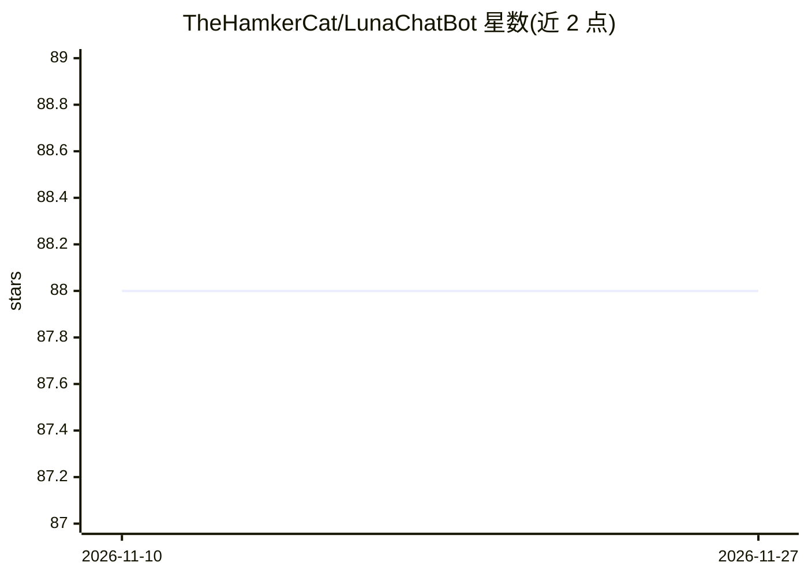

# TheHamkerCat/LunaChatBot

⭐ 88 · Python · MIT · 推送 2026-11-09 · [GitHub](https://github.com/TheHamkerCat/LunaChatBot) · [官网](https://t.me/LunaChatBot) · 个人维护

**基于 ARQ API 的 Telegram AI 聊天机器人**

用 Python 和 Telethon 编写的 Telegram AI 聊天机器人，回答来自 ARQ 的 /luna 端点，该端点会记住每个用户的对话上下文。私聊中回复所有文本消息，群组中仅响应包含 'Luna'、@提及或回复其消息的内容，支持 /start、/help、/repo 命令。运行需 Docker 或 Python 3.12+ 配合 uv、bot token 以及从 @ARQRobot 获取的 ARQ API key，支持 Docker Compose、直接运行和 Heroku 部署，公开实例为 @LunaChatBot。

## 筛选速览

| 维度 | 判定 | 备注 |
|---|---|---|
| AI 角色 | `ai-native` | 本体是模型或模型工具 |
| 许可风险 | `permissive` | MIT |
| 部署形态 | `self-host` | docker 或自建部署 |
| 模型依赖 | — | README 未给出锁定关系 |
| 硬件要求 | — | 无带数字的原话,不猜 |
| 安装摩擦 | `low` | 无编译、无系统依赖或容器化 |
| 成熟度 | — | 结构信号不足 |

## 能力要点

- 通过 ARQ /luna 端点生成回答并保留每用户对话记忆
- 私聊与群组分场景的响应触发规则
- 提供 Docker Compose、uv 直接运行与 Heroku 三种部署方式

## 适用场景

- 在 Telegram 私聊或群组中与 AI 聊天机器人对话
- 自行部署一个带上下文记忆的 Telegram 聊天机器人

## 场景标签

`聊天机器人` · 领域:对话与助手

## 证据(README 行号)

> L2: Telegram AI chat bot written in Python with Telethon. The answers come from the `/luna` endpoint of ARQ, which remem
> L9: - **Groups:** messages that say "Luna", mention the bot, or reply to one of its messages. For "Luna" without a menti

## 星数曲线

2026-11-10 88 → 2026-11-27 88（+0）

---
*卡片 v1 · prompt 1.4 · 生成 2026-11-17 · 置信度 mid · 依据 README sha `cb16e4ee9814` · [字段定义](../../DATASET.md)*
