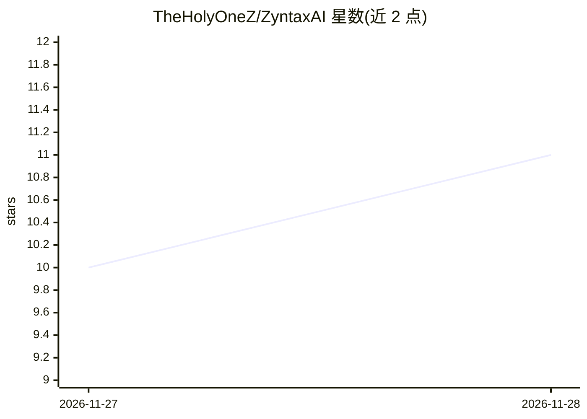

# TheHolyOneZ/ZyntaxAI

⭐ 11 · Rust · GPL-3.0 · 推送 2026-11-07 · [GitHub](https://github.com/TheHolyOneZ/ZyntaxAI) · [官网](https://zsync.eu/zyntaxai/) · 个人维护

**桌面全局热键文本纠错/改写/翻译工具，支持本地离线运行**

基于 Tauri 2（Rust + TypeScript）的跨平台桌面工具：在任意应用中选中文本、按下热键即可获得纠错、改写或翻译结果，先以词级 diff 浮层展示、确认后才写入原文。支持 Google Gemini、任意 OpenAI 兼容端点与完全本地离线的 Ollama 三类 provider，密钥存入系统 keychain；内置五种写作 persona、13 种目标语言与自定义语言，提供按模型计价的用量统计，无遥测。macOS 构建由 CI 编译但未在真实硬件上验证。

## 筛选速览

| 维度 | 判定 | 备注 |
|---|---|---|
| AI 角色 | `ai-native` | 本体是模型或模型工具 |
| 许可风险 | `viral` | GPL-3.0 |
| 部署形态 | `desktop` | 安装包/桌面程序 |
| 模型依赖 | local-ok | 支持本地模型 |
| 硬件要求 | — | 无带数字的原话,不猜 |
| 安装摩擦 | `medium` | 含编译或系统依赖之一 |
| 成熟度 | — | 结构信号不足 |

## 能力要点

- 全局热键触发，词级 diff 浮层确认后才应用修改
- 三类 provider：Gemini、OpenAI 兼容端点、本地 Ollama 离线运行
- 五种内置 persona 与自定义自由指令风格
- 用量面板按模型单价统计 token 与花费

## 适用场景

- 在任意桌面应用中一键纠正/改写选中文本
- 本地离线环境下保持文本不出机器地纠错
- 一次热键同时完成纠错与翻译
- 按模型统计 token 消耗与自定单价成本

## 场景标签

`AI 写作` · 领域:内容生成

## 证据(README 行号)

> L3: **Correct, rewrite and translate text anywhere on your desktop — with one hotkey.**
> L131: |**Ollama**|No|Runs entirely on your machine. No key, no network, and your text never leaves the computer|

## 星数曲线

2026-11-27 10 → 2026-11-28 11（+1）

---
*卡片 v1 · prompt 1.4 · 生成 2026-11-27 · 置信度 mid · 依据 README sha `17ce019a745d` · [字段定义](../../DATASET.md)*
