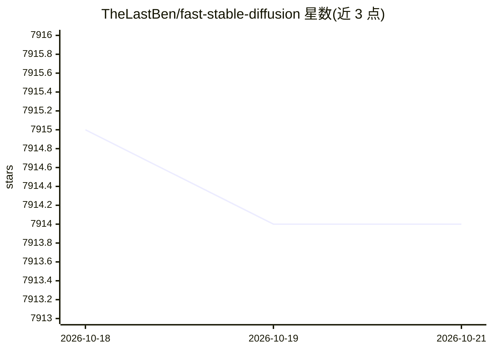

# TheLastBen/fast-stable-diffusion

⭐ 7,914 · Python · MIT · 推送 2025-11-29 · [GitHub](https://github.com/TheLastBen/fast-stable-diffusion) · 个人维护

**Colab 上的 Stable Diffusion / DreamBooth 训练笔记本集合**

在 Google Colab 中运行的 Stable Diffusion 相关笔记本集合，包含 ComfyUI、AUTOMATIC1111（A1111）WebUI 环境启动笔记本与 DreamBooth 训练笔记本（fast-DreamBooth.ipynb），面向希望免本地配置、直接在 Colab GPU 上运行 SD 工作流的用户。DreamBooth 部分基于 XavierXiao 的 Stable Diffusion 实现。README 另声明可通过 X 联系作者获取付费的 Flux 与 SDXL 训练器。文档极简，依赖 Colab 运行环境。

## 筛选速览

| 维度 | 判定 | 备注 |
|---|---|---|
| AI 角色 | `ai-ecosystem` | LLM/agent 周边工具 |
| 许可风险 | `permissive` | MIT |
| 部署形态 | `None` |  |
| 模型依赖 | — | README 未给出锁定关系 |
| 硬件要求 | — | 无带数字的原话,不猜 |
| 安装摩擦 | `low` | 无编译、无系统依赖或容器化 |
| 成熟度 | — | 结构信号不足 |

## 能力要点

- 提供 Colab 版 ComfyUI 与 AUTOMATIC1111 环境笔记本
- 提供 DreamBooth 训练笔记本 fast-DreamBooth.ipynb
- 基于 DreamBooth 论文与 XavierXiao 的 SD 实现

## 适用场景

- 在 Colab 上免本地配置运行 ComfyUI 或 A1111 WebUI
- 用 DreamBooth 在 Colab 上训练个性化 Stable Diffusion 模型
- 快速搭建 Stable Diffusion 图像生成环境

## 场景标签

`图像生成` `微调` · 领域:内容生成

## 证据(README 行号)

> L3: # fast-stable-diffusion Notebooks, ComfyUI + A1111 + DreamBooth
> L5:  &nbsp;&nbsp;&nbsp;&nbsp;&nbsp;&nbsp;&nbsp;&nbsp;&nbsp;&nbsp;Colab-ComfyUI&nbsp;&nbsp;&nbsp;&nbsp;&nbsp;&nbsp;&nbsp;
> L8: Dreambooth paper : https://dreambooth.github.io/

## 星数曲线

2026-10-18 7,915 → 2026-10-21 7,914（-1）

---
*卡片 v1 · prompt 1.4 · 生成 2026-10-20 · 置信度 high · 依据 README sha `9c9612d7d59c` · [字段定义](../../DATASET.md)*
