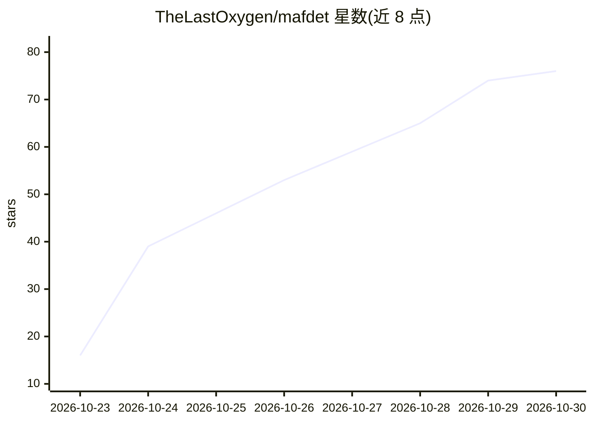

# TheLastOxygen/mafdet

⭐ 76 · Python · Apache-2.0 · 推送 2026-10-29 · [GitHub](https://github.com/TheLastOxygen/mafdet) · 个人维护

**边打字边预读预思考的本地 LLM 聊天应用**

本地运行的 LLM 聊天应用（GUI/TUI 双形态），基于 llama.cpp 引擎。核心机制：打字过程中增量维护 KV cache（最长公共前缀裁剪），使 Enter 后仅需处理少量 token；对 Qwen3 思考模式额外边打字边分段推理，推理笔记保留在提示中。Qwen3-4B 上平均等待从 12.2s 降至 3.2s。支持 Qwen3/Llama 3/Gemma 3/Mistral/Phi-4 五个模型家族，自动安装对应硬件的 llama.cpp 构建并下载模型。参考机型 RTX 2060 6GB，也可纯 CPU 运行；状态为 prototype，Linux 路径未测试。

## 筛选速览

| 维度 | 判定 | 备注 |
|---|---|---|
| AI 角色 | `ai-native` | 本体是模型或模型工具 |
| 许可风险 | `permissive` | Apache-2.0 |
| 部署形态 | `library` | 以包/库形式分发 |
| 模型依赖 | local-ok | 支持本地模型 |
| 硬件要求 | `cpu-ok` | |
| 安装摩擦 | `medium` | 含编译或系统依赖之一 |
| 成熟度 | `idea` | |

## 能力要点

- 打字期间增量维护 KV cache，Enter 后仅处理剩余少量 token
- Qwen3 思考模式下边打字边推理，笔记随文本修改保留
- 自动检测硬件并安装 llama.cpp（CUDA/CPU）构建与模型
- GUI 与 TUI 双形态，覆盖 0.6B–32B 五个模型家族

## 适用场景

- 在消费级 GPU 上降低本地推理模型的应答等待
- 边打字边让模型预读长消息减少 prefill 延迟
- 本地离线运行 Qwen3 思考模式并查看推理过程

## 场景标签

`聊天机器人` · 领域:对话与助手

## 证据(README 行号)

> L5: MAFDET reads your message while you type it, and **starts thinking about it before you send it**.
> L18: MAFDET uses the time you spend typing for both. It **reads** your message as you write it, so the prefill is done b
> L87: **Models.** Five families: **Qwen3**, **Llama 3**, **Gemma 3**, **Mistral** and **Phi-4**, from 0.6B to 32B paramet

## 星数曲线

2026-10-23 16 → 2026-10-30 76（+60）

---
*卡片 v1 · prompt 1.4 · 生成 2026-10-25 · 置信度 high · 依据 README sha `fe0e7e35f7e6` · [字段定义](../../DATASET.md)*
