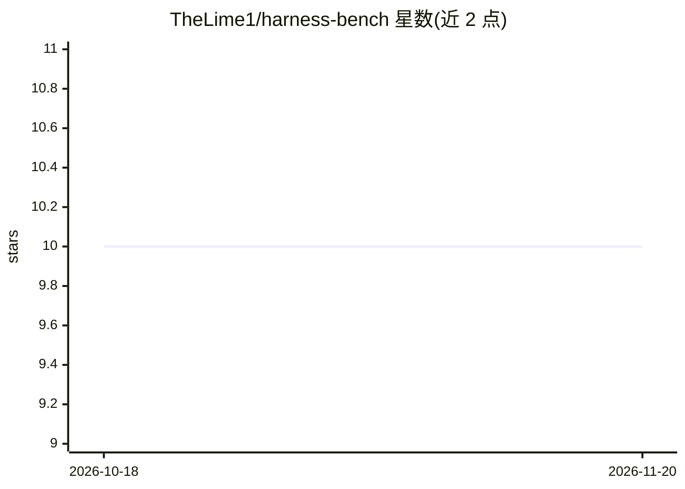

# TheLime1/harness-bench

⭐ 10 · TypeScript · MIT · 推送 2026-06-30 · [GitHub](https://github.com/TheLime1/harness-bench) · [官网](https://thelime1.github.io/harness-bench/) · 个人维护

**面向开发者的 AI 编码 harness 按模型维度评测榜单**

以 harness×模型×基准三维组织的数据仓库与静态榜单：每条运行记录 harness 名称/版本/配置、模型提供方与推理档位、基准套件、分数、成本、token 用量、日志与产物，并标注信任层级（self_reported/artifact_complete/maintainer_verified）。数据以 YAML 注册表与运行文件提交，经校验脚本生成 site-data.json，以 Vite+React 静态站点部署在 GitHub Pages。当前为 v1，数据为种子 fixture 加公开参考条目，依赖社区提交扩展。

## 筛选速览

| 维度 | 判定 | 备注 |
|---|---|---|
| AI 角色 | `ai-ecosystem` | LLM/agent 周边工具 |
| 许可风险 | `permissive` | MIT |
| 部署形态 | `library` | 以包/库形式分发 |
| 模型依赖 | — | README 未给出锁定关系 |
| 硬件要求 | — | 无带数字的原话,不猜 |
| 安装摩擦 | `low` | 无编译、无系统依赖或容器化 |
| 成熟度 | `idea` | |

## 能力要点

- 同一模型在不同 harness（Codex CLI/OpenCode/Zed/Aider 等）下的结果对比
- 记录分数、成本、token 用量、轨迹与信任层级
- 基准无关设计，可通过注册表 YAML 添加新基准套件
- pnpm 工作流：数据生成、校验、测试与静态站点构建

## 适用场景

- 比较同一模型在 Codex CLI、Aider 等不同编码工具中的表现
- 为编码 agent 基准结果提交可复现的运行记录
- 引用该榜单做模型与工具组合的评估报告

## 场景标签

`模型评测` · 领域:评测与运维

## 证据(README 行号)

> L3: **A benchmark leaderboard for AI coding harnesses by model.**
> L15: Harness-Bench asks a different question: **which harness gets the most out of a model on real coding-agent benchmar
> L7: > Status: early v1. The data model, contribution flow, and static leaderboard are in place; seeded results are fixtu

## 星数曲线

2026-10-18 10 → 2026-11-20 10（+0）

---
*卡片 v1 · prompt 1.4 · 生成 2026-11-20 · 置信度 mid · 依据 README sha `da5db9f885c0` · [字段定义](../../DATASET.md)*
