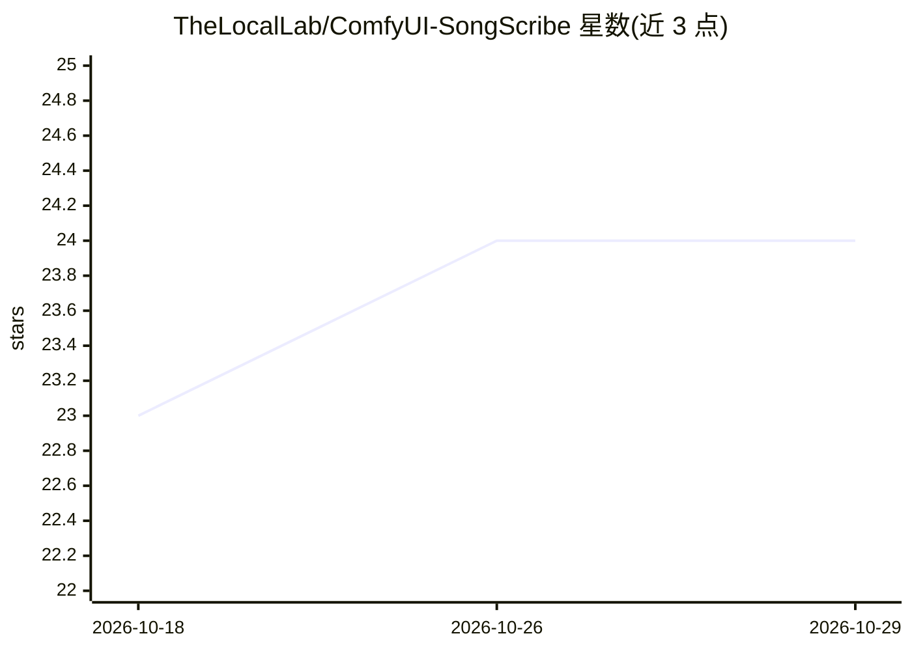

# TheLocalLab/ComfyUI-SongScribe

⭐ 24 · Python · MIT · 推送 2026-09-16 · [GitHub](https://github.com/TheLocalLab/ComfyUI-SongScribe) · [官网](https://locallabdigest.com/) · 个人维护

**ComfyUI 音乐提示词节点：73 风格预设与歌曲分析，服务 MiniMax/YuE2**

面向 ComfyUI 的自定义节点集，为 AI 音乐生成模型产出提示词：提供 73 个预设（14 类）的 Style Preset 节点，可按 MiniMax 三段式 caption 或 YuE2 逗号分隔格式输出；Song Analyzer 节点读取音频文件，测量 BPM、调性、动态与歌曲结构并生成 caption、歌词与时长，体裁识别可选 MAEST（需 trust_remote_code，非默认）。在 CPU 上运行，无需额外显存。另含 caption 拆分/重组与歌词结构改写节点。安装支持 ComfyUI Manager、手动克隆与 Windows 一键安装器。

## 筛选速览

| 维度 | 判定 | 备注 |
|---|---|---|
| AI 角色 | `ai-ecosystem` | LLM/agent 周边工具 |
| 许可风险 | `permissive` | MIT |
| 部署形态 | `desktop` | 安装包/桌面程序 |
| 模型依赖 | — | README 未给出锁定关系 |
| 硬件要求 | `cpu-ok` | |
| 安装摩擦 | `low` | 无编译、无系统依赖或容器化 |
| 成熟度 | — | 结构信号不足 |

## 能力要点

- 73 个风格预设、14 类，支持 minimax/yue2 两种输出格式
- Song Analyzer 测量 BPM/调性/歌曲结构，不可靠项不输出，支持缓存加速
- 读取 wav/flac/mp3 等 9 种以上格式，歌词可来自内嵌标签、.lrc/.txt 或 Whisper 转录（默认关闭）
- 纯 CPU 运行，输出 STRING/FLOAT 可接入任意音频工作流

## 适用场景

- 为 MiniMax Music 3 / YuE2 生成结构化风格提示词
- 把现有歌曲反推为 caption、歌词与时长喂给音乐模型
- 在 ComfyUI 中拆分、编辑并重组 caption 与歌词结构

## 场景标签

`提示工程` · 领域:Agent 开发

## 证据(README 行号)

> L5: **Style prompts and song captions for AI music generation in ComfyUI.** Pick a
> L14: Outputs plain `STRING` / `FLOAT`, so they fit any audio workflow. **Runs on CPU** —
> L100: Outputs `caption`, `lyrics`, `duration` — wire straight into MiniMax's

## 星数曲线

2026-10-18 23 → 2026-10-29 24（+1）

---
*卡片 v1 · prompt 1.4 · 生成 2026-10-27 · 置信度 mid · 依据 README sha `cf60eb7a7a60` · [字段定义](../../DATASET.md)*
