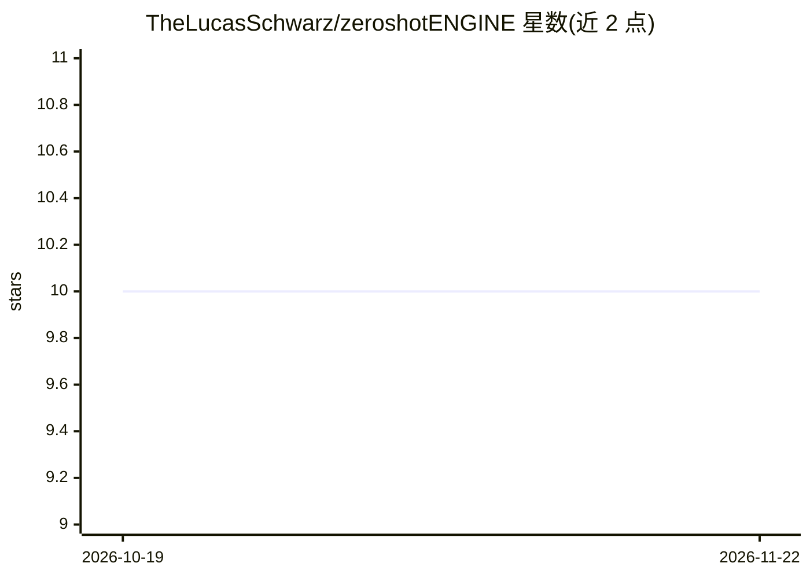

# TheLucasSchwarz/zeroshotENGINE

⭐ 10 · Python · Apache-2.0 · 推送 2026-03-07 · [GitHub](https://github.com/TheLucasSchwarz/zeroshotENGINE) · 个人维护

**面向社科研究者的 LLM 零样本文本分类 Python 包**

提供基于提示的零样本文本分类框架：通过自然语言提示将文本分类到目标类别，无需训练数据，支持多标签、多类别、迭代式（IZSC）与层级式（HZSC）分类流程，内置双重验证、重试与 pandas DataFrame 并行处理。为社会科学（尤其是政治传播）的学生与研究者设计，提供 CLI 演示、文档与教程；项目声明处于活跃开发中，可能存在缺陷与未完成功能。

## 筛选速览

| 维度 | 判定 | 备注 |
|---|---|---|
| AI 角色 | `ai-native` | 本体是模型或模型工具 |
| 许可风险 | `permissive` | Apache-2.0 |
| 部署形态 | `desktop` | 安装包/桌面程序 |
| 模型依赖 | local-ok | 支持本地模型 |
| 硬件要求 | — | 无带数字的原话,不猜 |
| 安装摩擦 | `low` | 无编译、无系统依赖或容器化 |
| 成熟度 | `idea` | |

## 能力要点

- 多标签/多类别、迭代式 IZSC 与层级式 HZSC 分类模块
- 支持 OpenAI、OpenRouter、Ollama 及任意 OpenAI 兼容 API
- 双重验证与自动重试机制，pandas DataFrame 并行分类
- 提供 CLI 交互演示与 Apache 2.0 开源许可

## 适用场景

- 对政治传播文本做系统性零样本分类研究
- 社科教学中让学生体验与评估零样本分类
- 构建多阶段的层级化文本分析流水线

## 场景标签

`科研工具` · 领域:学习与行业

## 证据(README 行号)

> L9: This project provides a flexible framework for performing zero-shot classification using large language models in Py
> L13: This package was developed as part of an academic research project to systematically classify political communicati

## 星数曲线

2026-10-19 10 → 2026-11-22 10（+0）

---
*卡片 v1 · prompt 1.4 · 生成 2026-11-20 · 置信度 high · 依据 README sha `e7d38fd9c9c3` · [字段定义](../../DATASET.md)*
