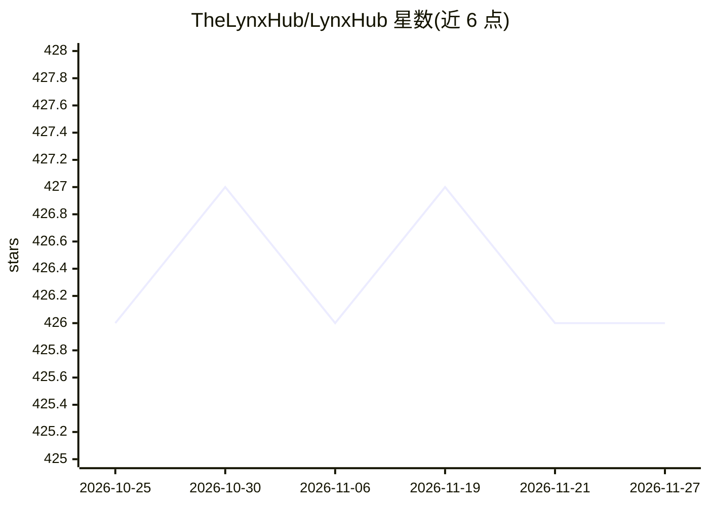

# TheLynxHub/LynxHub

⭐ 426 · TypeScript · AGPL-3.0 · 推送 2026-11-14 · [GitHub](https://github.com/TheLynxHub/LynxHub) · [官网](https://LynxHub.app) · 个人维护

**给 AI 高级用户的一站式本地 AI 接口管理桌面环境**

基于 Electron 的跨平台桌面环境，面向本地 AI 工具用户，将多个 AI WebUI 的安装、定位、配置与启动整合到统一工作区。核心机制：模块化架构允许开发者编写模块添加新 AI WebUI；参数管理器可视化组织启动参数；内置终端与浏览器多标签并行运行多个实例；提供 Git 分支切换、仓库重置、扩展批量更新等管理功能。支持 X64/ARM64 及 Portable 版本；macOS 为未签名应用，首次启动需手动绕过安全警告。

## 筛选速览

| 维度 | 判定 | 备注 |
|---|---|---|
| AI 角色 | `ai-ecosystem` | LLM/agent 周边工具 |
| 许可风险 | `viral` | AGPL-3.0 |
| 部署形态 | `library` | 以包/库形式分发 |
| 模型依赖 | — | README 未给出锁定关系 |
| 硬件要求 | — | 无带数字的原话,不猜 |
| 安装摩擦 | `low` | 无编译、无系统依赖或容器化 |
| 成熟度 | — | 结构信号不足 |

## 能力要点

- 模块化架构：开发者可创建并分享模块，为工作区添加新 AI WebUI
- 参数管理器：可视化添加/编辑启动参数并保存预设
- 内置终端与浏览器，多标签同时运行多个 AI 实例
- 扩展管理：查找、安装、批量更新 AI 扩展

## 适用场景

- 在一处统一安装、配置并启动多个本地 AI WebUI
- 通过内置终端和浏览器在多标签间切换管理 AI 实例
- 自定义 AI 接口的启动命令和启动前自动化操作

## 场景标签

 · 领域:AI 工具管理/开发工具

## 证据(README 行号)

> L17: _An open-source, highly modular environment built for AI power users to configure, manage, and run local AI interfa
> L33: - **Modular Design:** Developers can create and share modules that
> L36: 🚀 **Manage Your AI Interfaces:** Handle your AI WebUIs easily from one place.

## 星数曲线

2026-10-25 426 → 2026-11-27 426（+0）

---
*卡片 v1 · prompt 1.4 · 生成 2026-11-25 · 置信度 high · 依据 README sha `f1db7bffcec6` · [字段定义](../../DATASET.md)*
