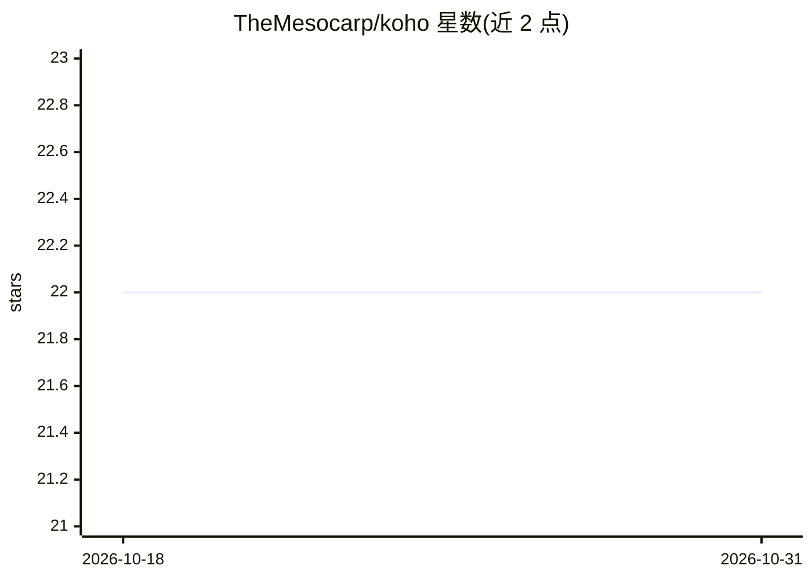

# TheMesocarp/koho

⭐ 22 · Rust · AGPL-3.0 · 推送 2026-10-01 · [GitHub](https://github.com/TheMesocarp/koho) · 个人维护

**Rust 层论（sheaf）神经网络库：在 CW 复形上做 k 维胞腔扩散**

基于 candle 深度学习框架构建的层论神经网络扩展实现，面向任意 CW 复形（胞腔复形）上的扩散建模。区别于聚焦 0 阶上同调与图设定的典型实现，本项目依据胞腔层的谱理论，直接从上边缘算子构造 Hodge Laplacian，再导出限制映射，从而支持在 k 维胞腔上做扩散。以 Rust crate 形式发布于 Crates.io，AGPL-3.0 许可。

## 筛选速览

| 维度 | 判定 | 备注 |
|---|---|---|
| AI 角色 | `ai-native` | 本体是模型或模型工具 |
| 许可风险 | `viral` | AGPL-3.0 |
| 部署形态 | `library` | 以包/库形式分发 |
| 模型依赖 | — | README 未给出锁定关系 |
| 硬件要求 | — | 无带数字的原话,不猜 |
| 安装摩擦 | `low` | 无编译、无系统依赖或容器化 |
| 成熟度 | — | 结构信号不足 |

## 能力要点

- 基于 candle 构建的层论神经网络实现
- 支持任意 CW 复形上 k 维胞腔的扩散
- 由上边缘算子直接构造 Hodge Laplacian 与限制映射

## 适用场景

- 研究胞腔复形上的层神经网络与扩散模型
- 拓扑数据分析相关的深度学习实验
- 图设定之外的高阶拓扑结构建模

## 场景标签

 · 领域:几何/拓扑深度学习

## 证据(README 行号)

> L6: Sheaf neural networks and other exotic diffusion models, built on `candle`.
> L10: This repository implements an extension of sheaf neural networks aimed to handle diffusion over k-cells in a cell c

## 星数曲线

2026-10-18 22 → 2026-10-31 22（+0）

---
*卡片 v1 · prompt 1.4 · 生成 2026-10-27 · 置信度 high · 依据 README sha `dd5f8ebdf68e` · [字段定义](../../DATASET.md)*
