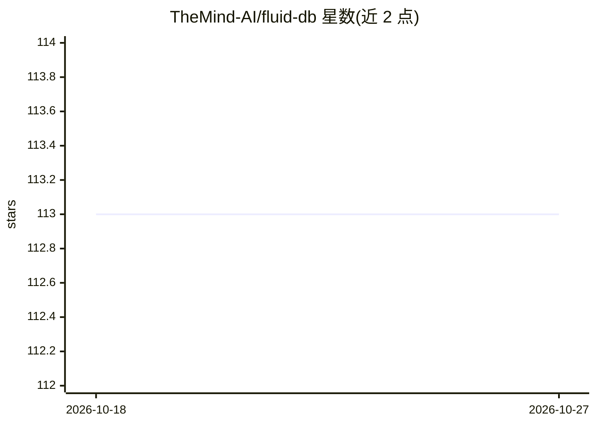

# TheMind-AI/fluid-db

⭐ 113 · TypeScript · Apache-2.0 · 推送 2026-09-30 · [GitHub](https://github.com/TheMind-AI/fluid-db) · [官网](https://themind.ai) · 组织维护

**给 AI 助手加对话记忆的 TypeScript 库：消息转可检索档案**

面向在产品中集成助手记忆的开发者库：将原始对话消息转为可检索窗口与陈述，链接重复事实与变更形成 dossier，每轮检索相关证据并生成可插入提示词的片段。单一 npm 包提供 SDK、SQLite/PostgreSQL/Firestore 适配器、MCP 服务器、CLI 与评测器；模型、嵌入、排序等组件均可替换，可部署为 Cloudflare Worker。限制：向量检索为精确线性，面向个人规模记忆，Worker 未认证支持生产流量；复述检测在实验室有较多误报。

## 筛选速览

| 维度 | 判定 | 备注 |
|---|---|---|
| AI 角色 | `ai-ecosystem` | LLM/agent 周边工具 |
| 许可风险 | `permissive` | Apache-2.0 |
| 部署形态 | `library` | 以包/库形式分发 |
| 模型依赖 | — | README 未给出锁定关系 |
| 硬件要求 | — | 无带数字的原话,不猜 |
| 安装摩擦 | `low` | 无编译、无系统依赖或容器化 |
| 成熟度 | — | 结构信号不足 |

## 能力要点

- 消息→窗口/陈述→链接重复与变更→dossier 的记忆流水线
- 单一 npm 包含 SDK、多存储适配器、MCP 服务器与评测器
- 模型/嵌入/排序/存储均为可替换接口，支持 OpenAI 与 OpenRouter
- 确定性假 provider + 内存 SQLite 的零成本评测与删除范围预览（previewForget）

## 适用场景

- 给我的聊天助手加上跨会话的用户记忆
- 在 PostgreSQL/SQLite/Firestore 中持久化并检索对话事实
- 通过 MCP 向 agent 暴露按人绑定的记忆工具
- 评测检索召回与重复事实检测质量

## 场景标签

`Agent 记忆` `模型评测` · 领域:Agent 开发

## 证据(README 行号)

> L3: TypeScript conversation memory: original messages → searchable windows and statements → linked repetitions and
> L72: The SDK, database adapters, MCP server, CLI, feedback, skills and evaluator ship together. Entry points load the
> L99: Use the SDK for automatic per-turn memory in a product. Choose PostgreSQL, local SQLite (Node or Bun), or

## 星数曲线

2026-10-18 113 → 2026-10-27 113（+0）

---
*卡片 v1 · prompt 1.4 · 生成 2026-10-23 · 置信度 high · 依据 README sha `00799ec677e5` · [字段定义](../../DATASET.md)*
