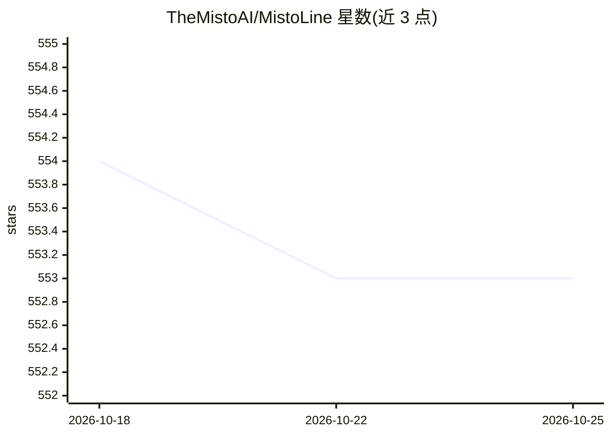

# TheMistoAI/MistoLine

⭐ 554 · NOASSERTION · 推送 2026-01-06 · [GitHub](https://github.com/TheMistoAI/MistoLine) · 组织维护 · 中文 README

**SDXL-ControlNet 模型：以各类线稿为条件生成图像**

基于 stable-diffusion-xl-base-1.0 Unet 重训的 SDXL-ControlNet 模型，配合自研 Anyline 线稿预处理算法，可适应手绘草图、不同 ControlNet 线稿预处理器输出、模型生成的轮廓等多种线稿输入，生成短边大于 1024px 的图像，免除按预处理器更换 ControlNet 模型的需要。兼容多数 SDXL 模型（PlaygroundV2.5、CosXL、SDXL-Lightning 除外），可与 LCM 及其他 ControlNet 配合。提供 ComfyUI 与 AUTOMATIC1111-WebUI 的 safetensors 权重、推荐参数与工作流 JSON；商用需按要求署名 TheMisto.ai。

## 筛选速览

| 维度 | 判定 | 备注 |
|---|---|---|
| AI 角色 | `ai-native` | 本体是模型或模型工具 |
| 许可风险 | `none` | NOASSERTION |
| 部署形态 | `None` |  |
| 模型依赖 | — | README 未给出锁定关系 |
| 硬件要求 | — | 无带数字的原话,不猜 |
| 安装摩擦 | `low` | 无编译、无系统依赖或容器化 |
| 成熟度 | — | 结构信号不足 |

## 能力要点

- 适应多种线稿输入的单一 ControlNet，免于按预处理器切换模型
- 基于 Anyline 预处理算法与 SDXL Unet 重训
- 提供 rank256 与 fp16 两版 safetensors 权重（ComfyUI / A1111-WebUI）
- 商用需在产品中署名 TheMisto.ai

## 适用场景

- 用草图/线稿控制 SDXL 生成效果图
- 建筑设计、工业设计草图的渲染上色
- 在 ComfyUI 或 AUTOMATIC1111-WebUI 中做线稿条件生成

## 场景标签

`图像生成` · 领域:内容生成

## 证据(README 行号)

> L24: MistoLine is an SDXL-ControlNet model that can adapt to any type of line art input, demonstrating high accuracy and
> L26: We developed MistoLine by employing a novel line preprocessing algorithm **Anyline** and retraining the ControlNet 

## 星数曲线

2026-10-18 554 → 2026-10-25 553（-1）

---
*卡片 v1 · prompt 1.4 · 生成 2026-10-21 · 置信度 high · 依据 README sha `5d8813c4b518` · [字段定义](../../DATASET.md)*
