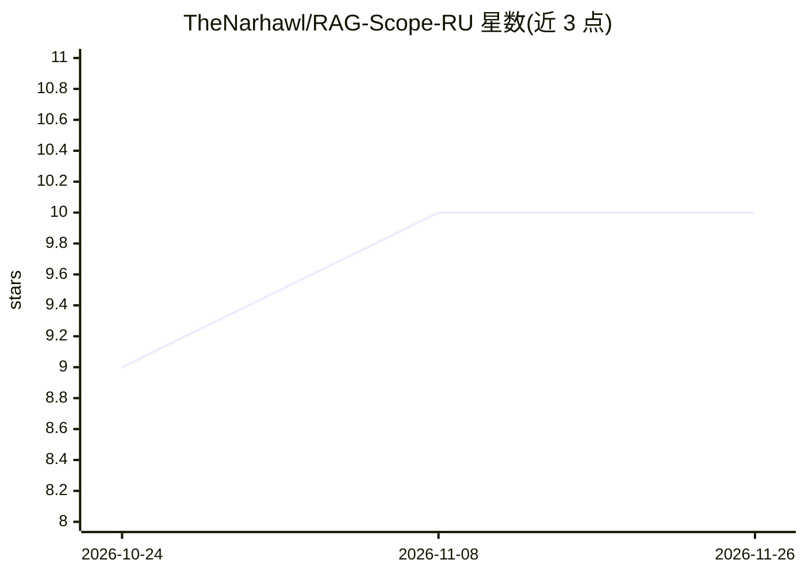

# TheNarhawl/RAG-Scope-RU

⭐ 10 · Jupyter Notebook · 推送 2026-11-08 · [GitHub](https://github.com/TheNarhawl/RAG-Scope-RU) · 个人维护

**俄语语料上 RAG 检索组件消融实验的研究沙盒**

面向俄语规范性技术文档（ГОСТ、СНиП、联邦法律等）的模块化 RAG 实验平台，可孤立更换并测量流水线关键参数的影响：嵌入模型、检索策略（Dense/BM25/混合 RRF）、Cross-Encoder 重排、PDF 解析方式（PyPDF vs PyMuPDF4LLM）与分块参数。评估分两阶段：先全矩阵快速测检索指标（Hit@K、MRR、延迟），再对帕累托前沿配置做 RAGAS 三元组（LLM-as-a-Judge）端到端评估。附 RRNCB 基准（65 份 PDF、200 个标注问题）与 78 次运行的汇总结果。

## 筛选速览

| 维度 | 判定 | 备注 |
|---|---|---|
| AI 角色 | `ai-ecosystem` | LLM/agent 周边工具 |
| 许可风险 | `none` | — |
| 部署形态 | `self-host` | docker 或自建部署 |
| 模型依赖 | local-ok | 支持本地模型 |
| 硬件要求 | — | 无带数字的原话,不猜 |
| 安装摩擦 | `low` | 无编译、无系统依赖或容器化 |
| 成熟度 | — | 结构信号不足 |

## 能力要点

- 配置矩阵生成与自动跳过已算配置的网格实验脚本
- 两阶段评估：检索全量筛选 + 仅帕累托前沿跑 RAGAS 生成评估
- 混合检索经 Qdrant Prefetch+RRF，含零向量 fallback 与资源泄漏清理
- A/B 解析器对比含 Wilcoxon/McNemar 检验与 bootstrap 置信区间

## 适用场景

- 在俄语规范文档语料上对比不同嵌入模型的检索质量
- 评估分块大小/重叠与结构化分块对 Hit@K 的影响
- 用 PyPDF 与 PyMuPDF4LLM 做解析质量 A/B 统计检验
- 租用 GPU 主机复现或扩展 RAG 消融实验

## 场景标签

`模型评测` `RAG` `科研工具` · 领域:评测与运维

## 证据(README 行号)

> L11: Модульная экспериментальная платформа (песочница) для исследования и оценки качества этапа поиска (Retrieval) и скв
> L33: |**Генерация и LLM-Judge (RAGAS)**|**Ragas**, **OpenAI API** (совместимость с DeepSeek, Ollama, vLLM)|Двухэтапная в

## 星数曲线

2026-10-24 9 → 2026-11-26 10（+1）

---
*卡片 v1 · prompt 1.4 · 生成 2026-11-20 · 置信度 high · 依据 README sha `cad09e7237d0` · [字段定义](../../DATASET.md)*
