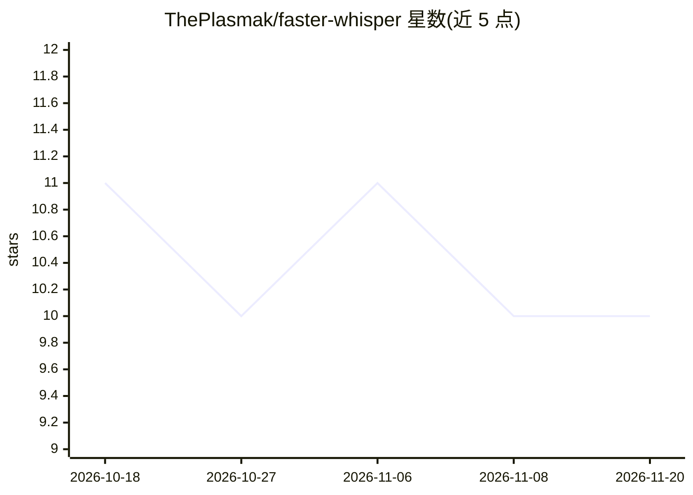

# ThePlasmak/faster-whisper

⭐ 10 · Python · MIT · 推送 2026-02-22 · [GitHub](https://github.com/ThePlasmak/faster-whisper) · [官网](https://clawhub.ai/ThePlasmak/faster-whisper) · 个人维护

**OpenClaw agent 技能：用 faster-whisper 转录音频并做说话人分离**

面向 OpenClaw agent 的技能包，封装 faster-whisper（Whisper 的 CTranslate2 重实现）提供音频转录脚本。通过 agent 自然语言指令或独立 CLI 调用，支持 99+ 语言自动检测、词级时间戳、VAD 去静音、多种字幕/文本格式输出、YouTube/URL/播客 RSS 输入（yt-dlp 下载）、英文翻译，以及基于 pyannote.audio 的说话人分离（可选安装）。提供 ClawHub/npm 安装、GitHub Releases 下载与 setup 脚本三条安装路径；ffmpeg 仅部分预处理功能需要。

## 筛选速览

| 维度 | 判定 | 备注 |
|---|---|---|
| AI 角色 | `ai-native` | 本体是模型或模型工具 |
| 许可风险 | `permissive` | MIT |
| 部署形态 | `desktop` | 安装包/桌面程序 |
| 模型依赖 | — | README 未给出锁定关系 |
| 硬件要求 | — | 无带数字的原话,不猜 |
| 安装摩擦 | `medium` | 含编译或系统依赖之一 |
| 成熟度 | — | 结构信号不足 |

## 能力要点

- 基于 CTranslate2 后端的 faster-whisper 转录，支持蒸馏模型
- 说话人分离（--diarize，依赖 pyannote.audio）与说话人音频导出
- 输出 SRT/VTT/ASS/LRC/TTML/HTML/JSON/CSV 等多种格式
- URL/播客 RSS 自动下载转录，词级时间戳自动对齐

## 适用场景

- 让 OpenClaw agent 直接转录音频文件或 YouTube 链接
- 为播客 RSS 订阅批量生成字幕与逐词时间戳
- 多人访谈录音按说话人分轨导出

## 场景标签

`语音识别` · 领域:感知与多模态

## 证据(README 行号)

> L3: A skill for your OpenClaw agent that uses faster-whisper to transcribe audio more quickly.
> L22: - **Speaker diarization** (`--diarize`) — labels who said what via pyannote.audio

## 星数曲线

2026-10-18 11 → 2026-11-20 10（-1）

---
*卡片 v1 · prompt 1.4 · 生成 2026-11-20 · 置信度 mid · 依据 README sha `1074206558a1` · [字段定义](../../DATASET.md)*
