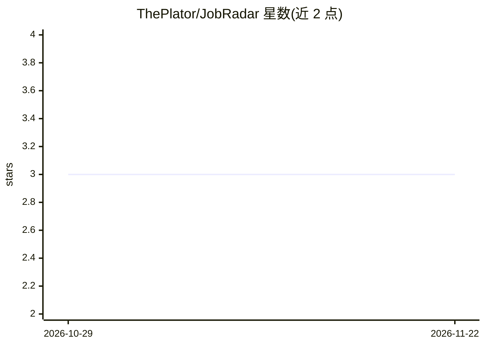

# ThePlator/JobRadar

⭐ 3 · Python · MIT · 推送 2026-11-18 · [GitHub](https://github.com/ThePlator/JobRadar) · [官网](https://jobradar.theplator.dev) · 个人维护

**自托管求职雷达：聚合去重职位并按匹配度排序**

面向求职者（尤其印度应届生）的自托管 agent：读取公司招聘站（Greenhouse/Lever/Ashby/Workday 等）公共 API、监控 Telegram 求职频道并接收邮件转发职位，先入队到本地 SQLite 再去重、隐藏频道广告、标记骗局。职位详情按成本分级提取：结构化数据与帖子标签优先，仅在缺失时调用 LLM 兜底；无 LLM key 时退化为技能重叠规则评分且不发提醒。输出 0–100 Match Score、邮件提醒、从 profile.yaml 事实定制的 LaTeX 简历 PDF、本地仪表盘与可选 Notion 页面；用户手动提交申请，工具不代投。

## 筛选速览

| 维度 | 判定 | 备注 |
|---|---|---|
| AI 角色 | `ai-enhanced` | 去掉 AI 部分产品仍成立 |
| 许可风险 | `permissive` | MIT |
| 部署形态 | `None` |  |
| 模型依赖 | — | README 未给出锁定关系 |
| 硬件要求 | — | 无带数字的原话,不猜 |
| 安装摩擦 | `low` | 无编译、无系统依赖或容器化 |
| 成熟度 | `idea` | |

## 能力要点

- 每 20–30 分钟经公共招聘 API 读取公司职位板，Telegram 实时监控
- 免费规则优先的分级提取：138/181 个职位无需 AI 调用
- 0–100 Match Score 附原因行，疑似骗局职位永不邮件推送
- 简历仅使用 profile.yaml 中的事实，检查器撤销虚构内容

## 适用场景

- 集中监控多个公司招聘页与 Telegram 求职群，免去逐个刷屏
- 按个人资格与技能筛选职位，只收到强匹配的邮件提醒
- 为入围职位一键生成基于个人真实经历的单页简历

## 场景标签

`工作流自动化` · 领域:效率与自动化

## 证据(README 行号)

> L9: JobRadar is an open-source, self-hosted agent. It reads company career sites directly (Greenhouse, Lever, Ashby, Sma
> L23: - **Free first.** Most details come from the job page's structured data and the post's own "Company: … Role: …" lin
> L40: 3. **Match:** one LLM request per job answers eligibility, role fit, skills coverage, seniority and location, each 

## 星数曲线

2026-10-29 3 → 2026-11-22 3（+0）

---
*卡片 v1 · prompt 1.4 · 生成 2026-11-22 · 置信度 high · 依据 README sha `e29b5b0f52cb` · [字段定义](../../DATASET.md)*
