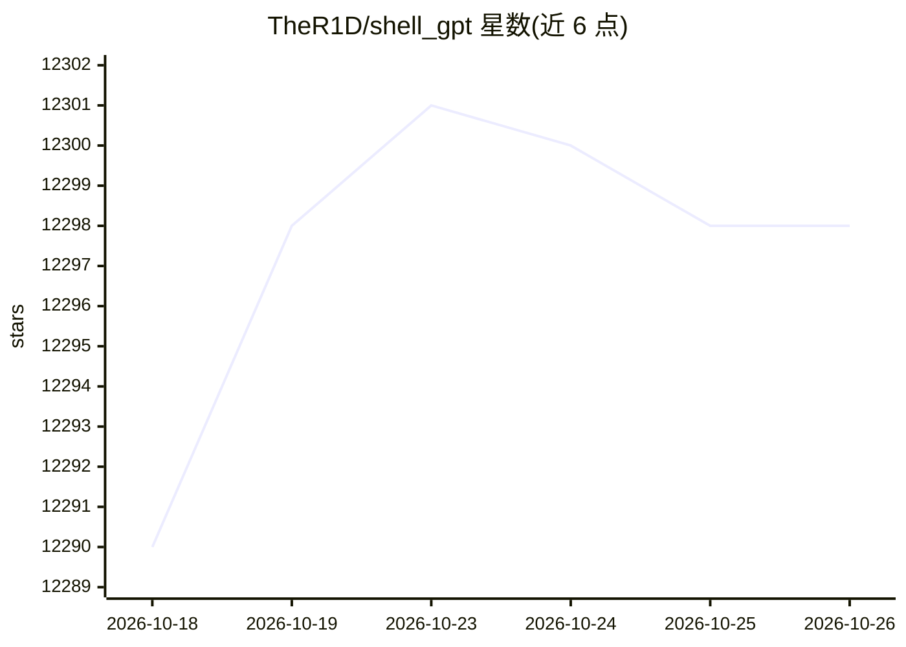

# TheR1D/shell_gpt

⭐ 12,298 · Python · MIT · 推送 2026-07-02 · [GitHub](https://github.com/TheR1D/shell_gpt) · 个人维护

**命令行 AI 助手：生成 shell 命令、代码与问答**

面向终端用户的 CLI 工具 sgpt，通过 LLM 在命令行中生成 shell 命令、代码片段与文本回答，支持 stdin/管道输入，可用于生成 git 提交信息、分析日志、摘要文档。默认调用 OpenAI API 与 GPT-4，需 API key（付费）；也可配合 Ollama 等本地后端，但 README 声明未对本地模型优化、可能不符预期。提供 shell 集成热键、会话缓存（chat/REPL 模式）与 OpenAI function calling 扩展机制。pip 安装，支持 Linux/macOS/Windows 及主流 Shell。

## 筛选速览

| 维度 | 判定 | 备注 |
|---|---|---|
| AI 角色 | `ai-native` | 本体是模型或模型工具 |
| 许可风险 | `permissive` | MIT |
| 部署形态 | `self-host` | docker 或自建部署 |
| 模型依赖 | local-ok | 支持本地模型 |
| 硬件要求 | — | 无带数字的原话,不猜 |
| 安装摩擦 | `low` | 无编译、无系统依赖或容器化 |
| 成熟度 | — | 结构信号不足 |

## 能力要点

- --shell/--code 模式生成并交互执行 shell 命令与纯代码
- chat 会话与 REPL 模式，会话可保存与回看
- Bash/Zsh shell 集成，热键调用并编辑建议命令
- 基于 OpenAI function calling 的自定义函数执行机制

## 适用场景

- 在终端快速生成并执行 shell 命令，免去查语法
- 基于 git diff 生成提交信息、分析日志找错误
- 通过会话模式迭代改进生成的代码

## 场景标签

`AI 助手` `代码生成` · 领域:编码与开发

## 证据(README 行号)

> L2: A command-line productivity tool powered by AI large language models (LLM). This command-line tool offers streamline
> L20: sgpt "What is the fibonacci sequence"

## 星数曲线

2026-10-18 12,290 → 2026-10-26 12,298（+8）

---
*卡片 v1 · prompt 1.4 · 生成 2026-10-20 · 置信度 mid · 依据 README sha `f4e8bcd4acad` · [字段定义](../../DATASET.md)*
