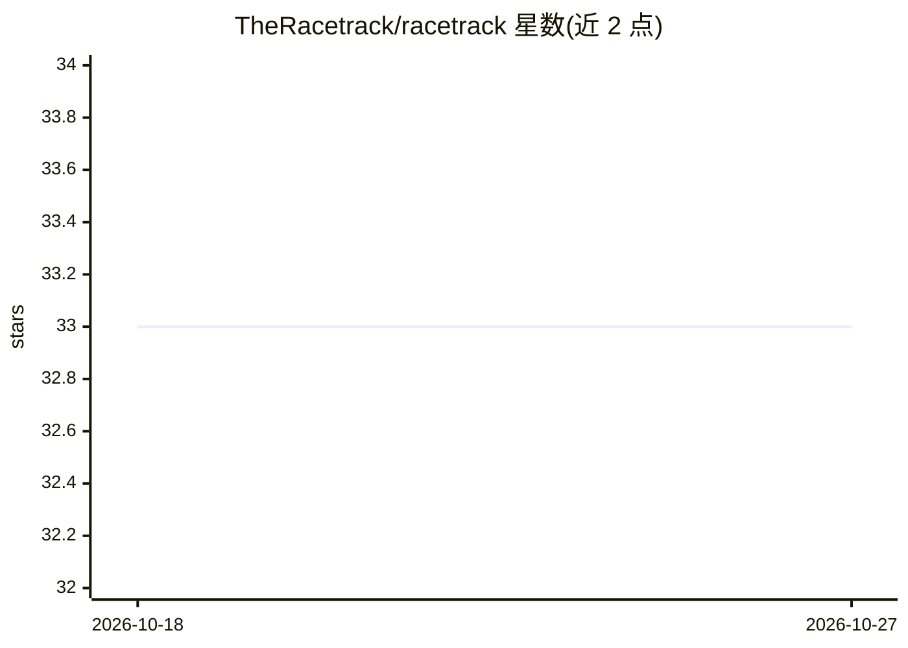

# TheRacetrack/racetrack

⭐ 33 · Python · Apache-2.0 · 推送 2026-07-27 · [GitHub](https://github.com/TheRacetrack/racetrack) · [官网](https://theracetrack.github.io/racetrack/) · 组织维护

**部署与管理应用工作负载的框架，含模型服务**

面向领域专家的工作负载部署框架：用户只提供函数逻辑（如 Python 类的 perform 方法）与 YAML 清单，通过 racetrack deploy 命令生成微服务 API，无需编写 API 代码、Web 服务器、Dockerfile 或 Kubernetes YAML。支持 Python 3、Go、Rust 及任意 Dockerfile 封装的语言，可部署到本地/远程 Kubernetes 或 Docker；部署后自动生成 Swagger 页面与 Prometheus 指标端点。插件机制扩展作业类型与部署目标。Apache 2.0 许可，由丹麦商业管理局与 deepsense.ai 合作开发。

## 筛选速览

| 维度 | 判定 | 备注 |
|---|---|---|
| AI 角色 | `ai-ecosystem` | LLM/agent 周边工具 |
| 许可风险 | `permissive` | Apache-2.0 |
| 部署形态 | `self-host` | docker 或自建部署 |
| 模型依赖 | — | README 未给出锁定关系 |
| 硬件要求 | — | 无带数字的原话,不猜 |
| 安装摩擦 | `low` | 无编译、无系统依赖或容器化 |
| 成熟度 | — | 结构信号不足 |

## 能力要点

- 用户只写函数逻辑，框架负责生成 API/服务与部署配置
- 支持 Python 3、Go、Rust 及任意 Dockerfile 封装语言
- 部署目标支持 Kubernetes 与 Docker（本地/远程），可插件扩展
- 部署后自动提供 Swagger 页面与 Prometheus 指标端点

## 适用场景

- 领域专家不熟悉基础设施也能快速上线模型或函数服务
- 将 ML/计算工作负载一键部署为可监控的微服务
- 统一管理多语言作业在 Kubernetes/Docker 上的部署

## 场景标签

`MLOps` · 领域:训练与推理

## 证据(README 行号)

> L9: Racetrack is a framework for deploying, managing, and serving application workloads.
> L24: These "jobs", in Racetrack lingo, can be deployed to different

## 星数曲线

2026-10-18 33 → 2026-10-27 33（+0）

---
*卡片 v1 · prompt 1.4 · 生成 2026-10-25 · 置信度 mid · 依据 README sha `9df6ee4feca9` · [字段定义](../../DATASET.md)*
