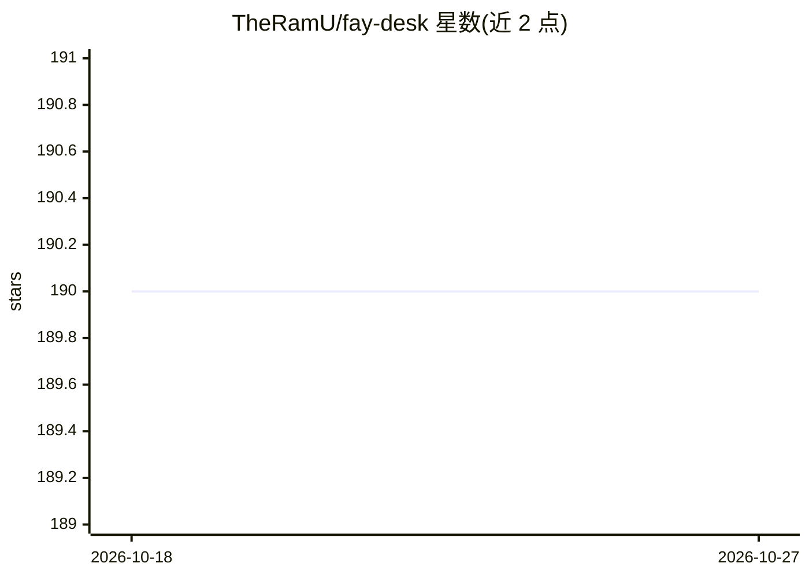

# TheRamU/fay-desk

⭐ 190 · TypeScript · MIT · 推送 2025-12-22 · [GitHub](https://github.com/TheRamU/fay-desk) · 组织维护 · 中文 README

**集成 AI 对话与动态壁纸的数字人桌面应用框架**

基于 Electron 的桌面应用框架，面向终端用户，功能包括：通过兼容 OpenAI API 的模型提供商进行 AI 对话（推荐 DeepSeek）；内置 HTML5 动态壁纸库并支持 zip 包导入自定义壁纸；基于 Xmov 具身驱动与云端渲染的数字人，根据对话内容实时生成表情与口型；全局快捷键与浮窗模式。用户从 GitHub Releases 下载安装程序安装，本地敏感配置加密存储。开发需 Node.js v22 与 pnpm。

## 筛选速览

| 维度 | 判定 | 备注 |
|---|---|---|
| AI 角色 | `ai-native` | 本体是模型或模型工具 |
| 许可风险 | `permissive` | MIT |
| 部署形态 | `library` | 以包/库形式分发 |
| 模型依赖 | — | README 未给出锁定关系 |
| 硬件要求 | — | 无带数字的原话,不猜 |
| 安装摩擦 | `low` | 无编译、无系统依赖或容器化 |
| 成熟度 | — | 结构信号不足 |

## 能力要点

- 接入兼容 OpenAI API 的模型提供商进行 AI 对话
- Xmov 具身驱动数字人，云端渲染降低本地硬件要求
- HTML5 动态壁纸库，支持 zip 包导入自定义壁纸
- 全局快捷键与浮窗模式

## 适用场景

- 在桌面上与 AI 数字人对话交流
- 使用动态壁纸并叠加浮窗对话
- 导入自定义壁纸包打造个人桌面

## 场景标签

`AI 助手` `聊天机器人` · 领域:对话与助手

## 证据(README 行号)

> L22: 通过集成兼容 OpenAI API 的模型提供商，体验强大的智能对话能力。无论是工作、学习还是日常闲聊，都能在应用中随时与 Fay 进行自然流畅的交流。
> L40: 基于 Xmov 具身驱动技术，将数字人形象融入桌面体验。通过简单的配置即可接入服务，数字人根据对话内容实时生成相应的表情和口型，营造出真实的面对面交流体验。

## 星数曲线

2026-10-18 190 → 2026-10-27 190（+0）

---
*卡片 v1 · prompt 1.4 · 生成 2026-10-22 · 置信度 high · 依据 README sha `bd6c964ebc25` · [字段定义](../../DATASET.md)*
