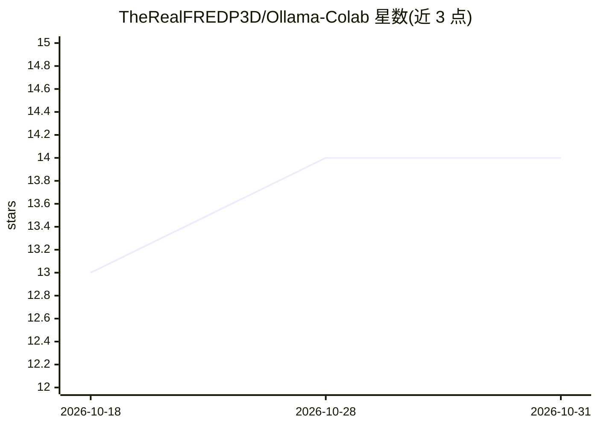

# TheRealFREDP3D/Ollama-Colab

⭐ 14 · Jupyter Notebook · MIT · 推送 2026-08-24 · [GitHub](https://github.com/TheRealFREDP3D/Ollama-Colab) · [官网](https://github.com/TheRealFREDP3D/Ollama-Colab) · 个人维护

**在 Google Colab 免费 GPU 上运行 Ollama 并暴露公网 HTTPS 端点的笔记本**

自教学性质的 Colab 笔记本：在 Colab GPU 实例上安装并启动 Ollama 服务，通过 Cloudflare Tunnel（快速/命名）或 ngrok 创建公网 HTTPS 端点，供 VS Code、curl、Python 脚本或 Claude Code 类客户端远程调用。包含交互式模型浏览器（抓取 Ollama 模型库并按检测到的 VRAM 过滤）、隧道就绪轮询、进程注册与清理关停。同时支持标准 Ollama API 与 Anthropic 兼容的 /v1/messages 端点（需 Ollama v0.14.0+）。限制：端点公开且无鉴权，仅建议短期实验使用；受 Colab 免费层时长与 T4（16 GB VRAM）限制。

## 筛选速览

| 维度 | 判定 | 备注 |
|---|---|---|
| AI 角色 | `ai-ecosystem` | LLM/agent 周边工具 |
| 许可风险 | `permissive` | MIT |
| 部署形态 | `None` |  |
| 模型依赖 | local-ok | 支持本地模型 |
| 硬件要求 | — | 无带数字的原话,不猜 |
| 安装摩擦 | `low` | 无编译、无系统依赖或容器化 |
| 成熟度 | — | 结构信号不足 |

## 能力要点

- 在 Colab GPU 实例上安装并后台运行 Ollama 服务
- 通过 Cloudflare Tunnel 或 ngrok 暴露公网 HTTPS 端点
- 交互式模型浏览器，默认按检测到的 GPU VRAM 过滤模型
- 支持标准 Ollama API 与 Anthropic 兼容 /v1/messages 端点

## 适用场景

- 没有本地 GPU 时临时跑 LLM 推理并通过公网 API 调用
- 从 VS Code 或 curl 等客户端远程访问 Colab 上的模型
- 快速实验不同模型在 T4 等 GPU 上的适配情况

## 场景标签

`推理引擎` · 领域:训练与推理

## 证据(README 行号)

> L3: Run Ollama on a free Google Colab GPU and expose a public HTTPS endpoint (Cloudflare Tunnel or ngrok) so you can use
> L11: - Installs Ollama on a Colab GPU instance
> L14: - Exposes the Ollama API over a public HTTPS tunnel

## 星数曲线

2026-10-18 13 → 2026-10-31 14（+1）

---
*卡片 v1 · prompt 1.4 · 生成 2026-10-31 · 置信度 high · 依据 README sha `5088084a8065` · [字段定义](../../DATASET.md)*
