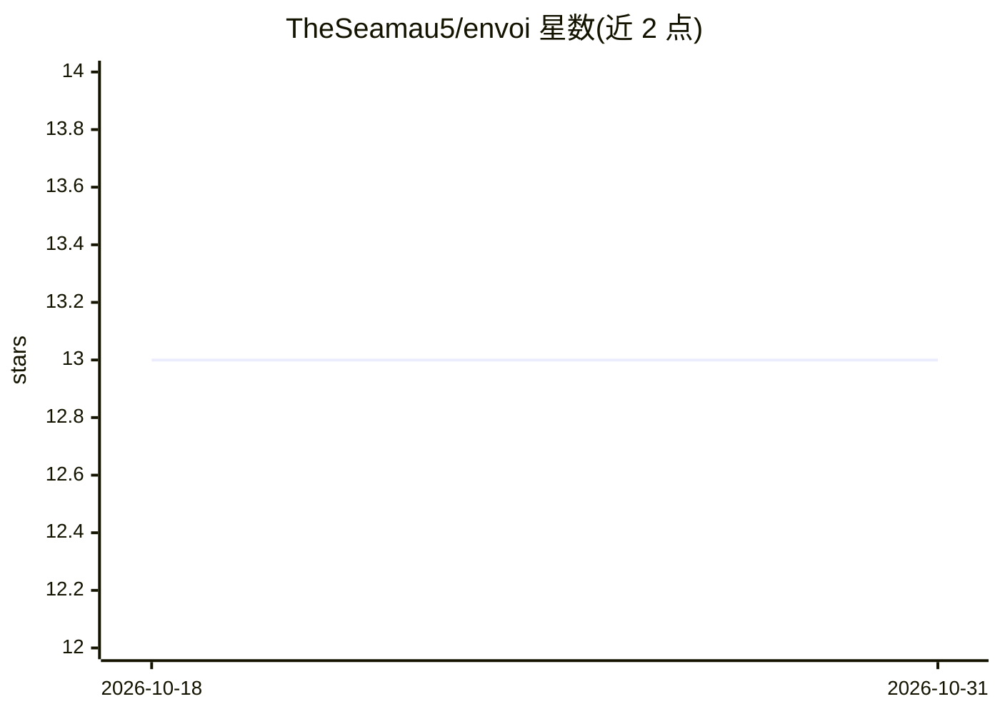

# TheSeamau5/envoi

⭐ 13 · Python · Apache-2.0 · 推送 2026-04-08 · [GitHub](https://github.com/TheSeamau5/envoi) · [官网](https://thesyntheticdatacompany.com) · 个人维护

**构建 AI 代码评测环境 HTTP 服务的 Python SDK**

Envoi 是一个 Python SDK，用于将装饰器标注的异步测试函数（@envoi.test/@envoi.setup/@envoi.teardown）转换为 FastAPI HTTP 服务，供脚本、CI 流水线或 AI 编码 agent 调用：客户端上传代码、触发构建、运行单个或参数化测试套件并以 JSON 返回结构化结果。会话型环境为每个会话生成隔离 worker 进程并含不活动超时；支持 Docker 部署（可自带 Dockerfile 安装编译器等依赖）。Monorepo 另含编排 AI 编码 agent 的 envoi-code 与统一 CLI 包。面向需要验证 AI 生成代码是否可用的开发者。

## 筛选速览

| 维度 | 判定 | 备注 |
|---|---|---|
| AI 角色 | `ai-ecosystem` | LLM/agent 周边工具 |
| 许可风险 | `permissive` | Apache-2.0 |
| 部署形态 | `self-host` | docker 或自建部署 |
| 模型依赖 | — | README 未给出锁定关系 |
| 硬件要求 | — | 无带数字的原话,不猜 |
| 安装摩擦 | `low` | 无编译、无系统依赖或容器化 |
| 成熟度 | — | 结构信号不足 |

## 能力要点

- 装饰器测试函数转为 FastAPI 评测服务
- 会话型环境：setup/teardown 生命周期与每会话隔离 worker 进程
- 参数化测试通过 URL 模板变量传参
- 支持 Docker 部署，示例含 250+ 测试程序的 C 编译器评测环境

## 适用场景

- 为 AI 编码 agent 搭建可编程调用的代码测试 harness
- 在 CI 中隔离运行 AI 生成代码的编译与测试
- 按章节/参数分批评测长周期任务的产物

## 场景标签

`模型评测` · 领域:评测与运维

## 证据(README 行号)

> L3: Envoi is a Python SDK for building **evaluation environments** — HTTP servers that test whether AI-generated code ac
> L5: You write async Python functions that define what "correct" means. Envoi turns them into an API that any client can 
> L17: Envoi is a framework for building these harnesses.

## 星数曲线

2026-10-18 13 → 2026-10-31 13（+0）

---
*卡片 v1 · prompt 1.4 · 生成 2026-10-31 · 置信度 high · 依据 README sha `dbbc5a578070` · [字段定义](../../DATASET.md)*
