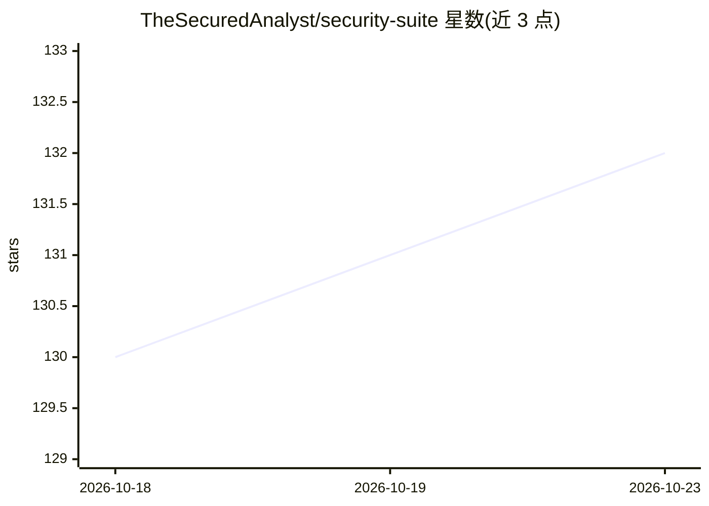

# TheSecuredAnalyst/security-suite

⭐ 132 · Python · AGPL-3.0 · 推送 2026-10-16 · [GitHub](https://github.com/TheSecuredAnalyst/security-suite) · 个人维护

**开源安全测试套件：OSINT、Web/API 扫描与 SIEM 集成，含 AI 分析**

面向安全测试人员的命令行工具套件，模块覆盖 OSINT 侦察（DNS/WHOIS/子域名）、Web 漏洞扫描（XSS/SQLi/Nuclei）、源码扫描（密钥泄露、依赖漏洞、SARIF 输出）、API 安全测试（OpenAPI 解析、BOLA/IDOR、JWT、模糊测试）、关联分析（YAML 规则生成攻击路径）、SIEM 输出（Splunk/Elasticsearch/Syslog）与合规评估。AI 为其中一个模块：通过 Ollama 本地模型或 Anthropic/OpenAI API key 做漏洞关联、摘要与交互式修复指导；setup 脚本自动安装 Ollama 与本地模型，核心功能无需任何 API key。提供 REST API 与定时扫描。

## 筛选速览

| 维度 | 判定 | 备注 |
|---|---|---|
| AI 角色 | `ai-enhanced` | 去掉 AI 部分产品仍成立 |
| 许可风险 | `viral` | AGPL-3.0 |
| 部署形态 | `library` | 以包/库形式分发 |
| 模型依赖 | local-ok | 支持本地模型 |
| 硬件要求 | — | 无带数字的原话,不猜 |
| 安装摩擦 | `low` | 无编译、无系统依赖或容器化 |
| 成熟度 | — | 结构信号不足 |

## 能力要点

- setup 脚本一键安装依赖、Ollama 与本地 AI 模型
- AI 分析与交互式修复指导支持本地 Ollama，无需 API key
- YAML 声明式关联规则将发现转化为溯源攻击路径
- FastAPI REST API 可编程触发扫描并集成 Splunk/Elasticsearch/Syslog

## 适用场景

- 对目标域名做 OSINT 侦察与 Web/API 安全测试
- 用本地 LLM 分析扫描结果并交互式修复漏洞
- 将扫描结果接入 SIEM 做持续监控

## 场景标签

`网络安全` · 领域:学习与行业

## 证据(README 行号)

> L9: A comprehensive open-source security tools suite for OSINT reconnaissance, web security testing, API security assess
> L78: |**AI Analysis**|Finding correlation, executive summaries, interactive LLM remediation|Ollama, Anthropic, OpenAI|
> L297: ### AI-Powered Analysis

## 星数曲线

2026-10-18 130 → 2026-10-23 132（+2）

---
*卡片 v1 · prompt 1.4 · 生成 2026-10-22 · 置信度 mid · 依据 README sha `209aa2960b3f` · [字段定义](../../DATASET.md)*
