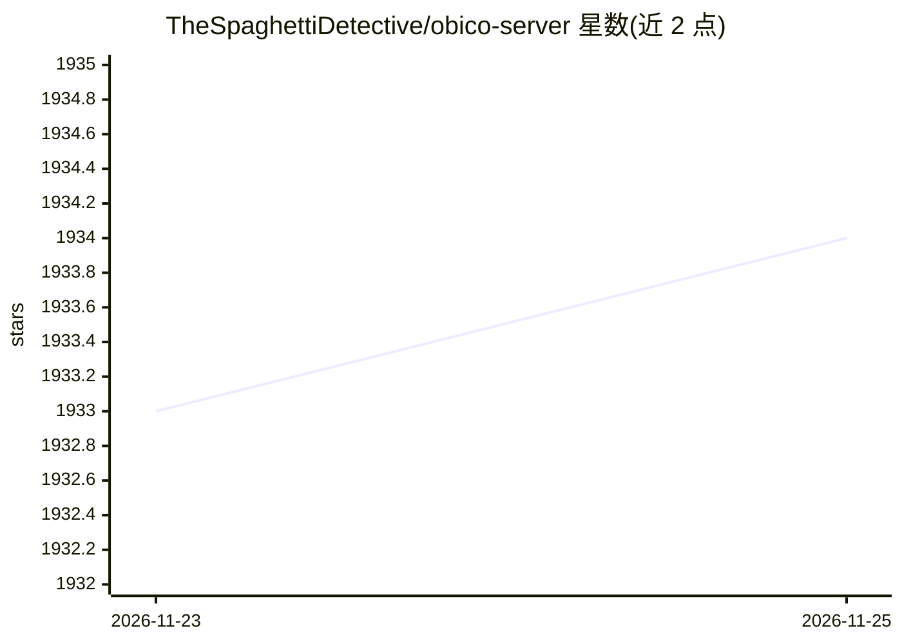

# TheSpaghettiDetective/obico-server

⭐ 1,934 · Vue · AGPL-3.0 · 推送 2026-11-23 · [GitHub](https://github.com/TheSpaghettiDetective/obico-server) · [官网](https://www.obico.io/docs/server-guides/) · 组织维护

**3D 打印机 AI 失败检测与远程监控的自托管服务器**

Obico Server 通过打印机摄像头快照运行深度学习模型检测打印失败（如拉丝、零件脱落），自动告警并暂停打印；支持浏览器与 iOS/Android 应用远程查看和控制打印机，经 Apprise 发送 Telegram/Discord/Slack/邮件等通知。通过 OctoPrint 插件或 Klipper 插件（Mainsail/Fluidd/Creality K1/Sonic Pad）连接打印机。以 Docker Compose 部署，可在十年内的旧 PC 运行，GPU 加速可选；另有官方云端运行同代码。

## 筛选速览

| 维度 | 判定 | 备注 |
|---|---|---|
| AI 角色 | `ai-native` | 本体是模型或模型工具 |
| 许可风险 | `viral` | AGPL-3.0 |
| 部署形态 | `self-host` | docker 或自建部署 |
| 模型依赖 | — | README 未给出锁定关系 |
| 硬件要求 | — | 无带数字的原话,不猜 |
| 安装摩擦 | `low` | 无编译、无系统依赖或容器化 |
| 成熟度 | — | 结构信号不足 |

## 能力要点

- 深度学习模型检测打印失败并自动暂停或告警
- 支持 OctoPrint 与 Klipper（Mainsail/Fluidd）插件接入
- NVIDIA CUDA、Intel OpenVINO 与 RK3588 NPU 加速
- Docker Compose 一键自托管，支持多云主机部署

## 适用场景

- 在家自托管服务器监控 3D 打印，失败时自动暂停
- 通过浏览器或手机远程查看摄像头画面并控制打印机
- 旧电脑上搭建多打印机监控服务

## 场景标签

`目标检测` · 领域:感知与多模态

## 证据(README 行号)

> L10: Obico (formerly The Spaghetti Detective) watches your prints through the printer's webcam. When the AI sees a print
> L16: - **AI failure detection.** A deep-learning model checks webcam snapshots during the print, and pauses it or alerts

## 星数曲线

2026-11-23 1,933 → 2026-11-25 1,934（+1）

---
*卡片 v1 · prompt 1.4 · 生成 2026-11-23 · 置信度 high · 依据 README sha `6779d1f38ffe` · [字段定义](../../DATASET.md)*
