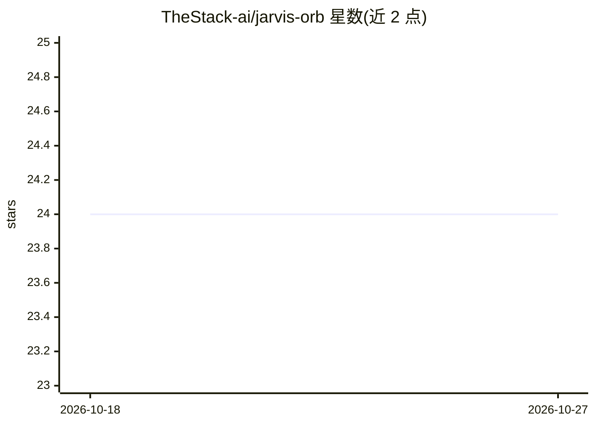

# TheStack-ai/jarvis-orb

⭐ 24 · Python · MIT · 推送 2026-04-28 · [GitHub](https://github.com/TheStack-ai/jarvis-orb) · [官网](https://jarvis-brain-visualizer.vercel.app) · 组织维护 · 中文 README

**给 Claude Code/Cursor 的持久记忆 MCP 服务器与 3D 思维可视化 Orb**

由两部分组成：Brain Lite 是本地运行的 MCP 服务器，用 Python/aiosqlite/FTS5 在 ~/.jarvis-orb/brain.db 中存储跨会话记忆，提供 4 层记忆分类、30 天半衰期时间评分、矛盾检测、实体状态追踪与轻量知识图谱，暴露 7 个 MCP 工具；Orb 是 3MB 的 Tauri 桌面悬浮应用，通过 WebSocket 将记忆保存、矛盾检测等事件以 3D 动画实时呈现。面向使用 Claude Code、Cursor、Windsurf 等 MCP 兼容工具的开发者，安装为 curl/PowerShell 一键脚本。限制：Linux 下 Orb 桌面端尚不可用，官方提示需 Apple Silicon 获得最顺滑体验。

## 筛选速览

| 维度 | 判定 | 备注 |
|---|---|---|
| AI 角色 | `ai-ecosystem` | LLM/agent 周边工具 |
| 许可风险 | `permissive` | MIT |
| 部署形态 | `library` | 以包/库形式分发 |
| 模型依赖 | — | README 未给出锁定关系 |
| 硬件要求 | — | 无带数字的原话,不猜 |
| 安装摩擦 | `low` | 无编译、无系统依赖或容器化 |
| 成熟度 | — | 结构信号不足 |

## 能力要点

- 4 层记忆（情景/语义/项目/过程式）自动分类与 30 天半衰期排序
- 矛盾检测与记忆验证（verified/superseded/contradicted）
- 7 个 MCP 工具，兼容 Claude Code/Cursor 等 MCP 客户端
- 3MB Tauri 桌面 Orb 实时可视化大脑事件，0 云端依赖全本地

## 适用场景

- 让 Claude Code/Cursor 在新会话中延续项目决策与偏好
- 回看上周工作进展而无需翻聊天记录
- 发现 AI 建议与既有决策冲突时通过 Orb 悬浮动画即时察觉

## 场景标签

`Agent 记忆` `知识图谱` · 领域:Agent 开发

## 证据(README 行号)

> L31: **Jarvis Orb** gives your AI a persistent brain and shows its thought process as a living orb on your desktop.
> L113: Works with **Claude Code**, **Cursor**, and any MCP-compatible tool.
> L146: Claude Code / Cursor

## 星数曲线

2026-10-18 24 → 2026-10-27 24（+0）

---
*卡片 v1 · prompt 1.4 · 生成 2026-10-27 · 置信度 mid · 依据 README sha `8fa4338ed021` · [字段定义](../../DATASET.md)*
