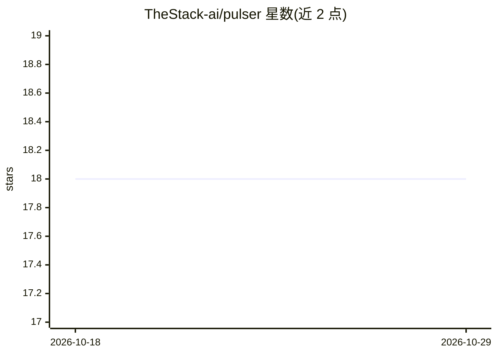

# TheStack-ai/pulser

⭐ 18 · TypeScript · MIT · 推送 2026-06-30 · [GitHub](https://github.com/TheStack-ai/pulser) · [官网](https://thestack-ai.github.io/pulser/) · 组织维护

**Claude Code 的 SKILL.md 检查工具：按 8 条规则诊断并修复技能**

面向 Claude Code 技能作者的 CLI 工具：扫描 SKILL.md 文件，依据 Anthropic 在 Building Claude Code: How We Use Skills 中发布的原则执行 8 条诊断规则（frontmatter、描述写法、500 行限制、gotchas 章节、工具限制、结构、关键词冲突、usage-hooks），按技能类型（analysis/research/generation/execution/reference）自动分类并给出定制修复建议，可自动应用结构性修复并支持回滚。安装后注册为 Claude Code 技能，可在对话中说 check my skills 或 /pulser 调用；v0.4.0 新增 eval 命令，通过 claude -p 对真实输入跑测试并跟踪回归。

## 筛选速览

| 维度 | 判定 | 备注 |
|---|---|---|
| AI 角色 | `ai-ecosystem` | LLM/agent 周边工具 |
| 许可风险 | `permissive` | MIT |
| 部署形态 | `library` | 以包/库形式分发 |
| 模型依赖 | — | README 未给出锁定关系 |
| 硬件要求 | — | 无带数字的原话,不猜 |
| 安装摩擦 | `low` | 无编译、无系统依赖或容器化 |
| 成熟度 | — | 结构信号不足 |

## 能力要点

- 8 条源自 Anthropic 发布原则的诊断规则
- 技能类型自动分类与置信度评分
- 自动应用安全修复并支持即时回滚
- eval 命令通过 claude -p 跑技能测试并检测回归

## 适用场景

- 检查我的 SKILL.md 是否符合 Anthropic 技能编写最佳实践
- 在 CI 中检测技能质量并跟踪回归
- 在 Claude Code 对话内直接诊断和修复技能问题

## 场景标签

 · 领域:开发者工具/Claude Code 生态

## 证据(README 行号)

> L28: pulser scans your `SKILL.md` files against 8 diagnostic rules derived from Anthropic's published principles in "Bui
> L49: On install, pulser registers itself as a Claude Code skill — say "check my skills" or `/pulser` to run it conversat
> L95: pulser runs each test through `claude -p`, checks assertions, and tracks regressions automatically.

## 星数曲线

2026-10-18 18 → 2026-10-29 18（+0）

---
*卡片 v1 · prompt 1.4 · 生成 2026-10-29 · 置信度 high · 依据 README sha `1ecfee566620` · [字段定义](../../DATASET.md)*
