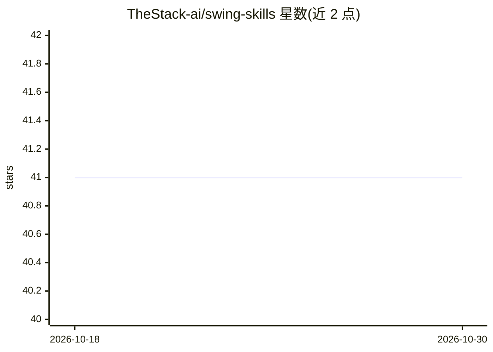

# TheStack-ai/swing-skills

⭐ 41 · MIT · 推送 2026-04-30 · [GitHub](https://github.com/TheStack-ai/swing-skills) · [官网](https://thestack-ai.github.io/swing-skills/) · 组织维护

**面向 Claude Code 的 6 个认知防护技能，约束 AI 幻觉与偏见**

一组按 Agent Skills 开放标准编写的 Claude Code 技能（skills），针对六类认知失败各设一道“防火墙”：swing-clarify 在执行前做 5W1H 澄清、swing-research 强制来源溯源与交叉验证并按 S/A/B/C 分级、swing-options 生成概率加权选项、swing-review 先钢化论证再从三个向量攻击并禁用“看起来不错”、swing-trace 输出假设清单与决策树、swing-mortem 假定失败回推 5 个场景。各技能可独立或链式调用，通过 npx skills add 安装，兼容 Cursor、GitHub Copilot、Codex CLI。

## 筛选速览

| 维度 | 判定 | 备注 |
|---|---|---|
| AI 角色 | `ai-ecosystem` | LLM/agent 周边工具 |
| 许可风险 | `permissive` | MIT |
| 部署形态 | `library` | 以包/库形式分发 |
| 模型依赖 | — | README 未给出锁定关系 |
| 硬件要求 | — | 无带数字的原话,不猜 |
| 安装摩擦 | `low` | 无编译、无系统依赖或容器化 |
| 成熟度 | — | 结构信号不足 |

## 能力要点

- 6 个独立技能分别针对幻觉、锚定、确认偏差、黑箱推理等认知失败
- swing-research 强制声明溯源、交叉验证与 S/A/B/C 来源分级
- swing-review 先钢化论证再从逻辑/边界/结构三向量审查并给出分级结论
- 技能按需加载（约 100 token 扫描成本），可链式组合

## 适用场景

- 让 AI 编码助手在执行模糊需求前先澄清假设
- 技术调研时强制 AI 给出可引用来源并交叉验证
- 对代码或架构决策做结构化对抗性审查
- 项目启动前做预演式失败分析

## 场景标签

`提示工程` `代码审查` · 领域:Agent 开发

## 证据(README 行号)

> L28: > Built for Claude Code | Compatible with AI agents via Agent Skills open standard
> L220: 3. **Portability** — `npx skills add` works across Claude Code, Cursor, Copilot. A system prompt is locked to one 
> L259: |Claude Code|Fully supported|

## 星数曲线

2026-10-18 41 → 2026-10-30 41（+0）

---
*卡片 v1 · prompt 1.4 · 生成 2026-10-25 · 置信度 high · 依据 README sha `46842e1bb8b8` · [字段定义](../../DATASET.md)*
