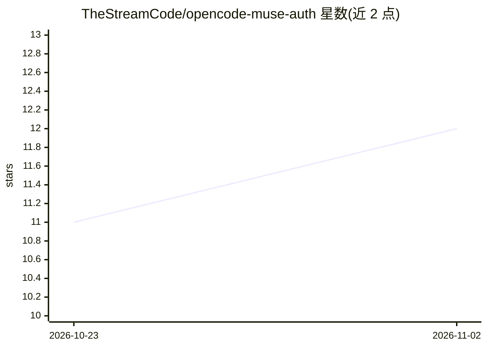

# TheStreamCode/opencode-muse-auth

⭐ 12 · TypeScript · MIT · 推送 2026-10-31 · [GitHub](https://github.com/TheStreamCode/opencode-muse-auth) · [官网](https://www.npmjs.com/package/opencode-muse-auth) · 个人维护

**为 opencode 接入 Muse Code 订阅登录的认证插件**

TypeScript 编写的 opencode 插件，为内置 meta provider 注册 Muse Code 订阅登录方式：通过 RFC 8628 设备码流程在 /connect 内完成 Meta 登录，铸造账号绑定的推理密钥，无需手动复制 API key。V2 插件 API 下运行本地环回 wire adapter，别名化与 Muse Code 内置工具冲突的客户端工具名并归一化 Meta 拒绝的参数。README 声明为非官方实验性项目，Meta 条款可能限制此用法并可能封禁账号；需 opencode 2.2.4+、Node.js 22.6+ 及有效 Muse Code 订阅。

## 筛选速览

| 维度 | 判定 | 备注 |
|---|---|---|
| AI 角色 | `ai-ecosystem` | LLM/agent 周边工具 |
| 许可风险 | `permissive` | MIT |
| 部署形态 | `library` | 以包/库形式分发 |
| 模型依赖 | — | README 未给出锁定关系 |
| 硬件要求 | — | 无带数字的原话,不猜 |
| 安装摩擦 | `low` | 无编译、无系统依赖或容器化 |
| 成熟度 | `idea` | |

## 能力要点

- 设备码流程（RFC 8628）登录并铸造账号绑定推理密钥，OAuth token 仅存内存不落盘
- V2 本地环回 wire adapter 处理工具名冲突与参数归一化，失败时全量别名重试一次
- 凭证存于 opencode auth store / integration store，附带旧缓存只读回退
- 环境变量 MUSE_CODE_ADAPTER=off 可关闭工具名重塑与参数归一化

## 适用场景

- 在 opencode 中用 Muse Code 订阅而非 API key 使用 muse-* 模型
- 让与 Muse Code 内置工具同名的客户端工具绕过 Meta 的客户端门禁
- 通过 /connect 设备码浏览器授权完成订阅登录

## 场景标签

 · 领域:LLM 基础设施/开发工具

## 证据(README 行号)

> L9: opencode plugin that registers the **Muse Code subscription** login method for the built-in `meta`
> L50: - Runs the Meta device-code exchange (RFC 8628) inside `/connect`, then mints the subscription

## 星数曲线

2026-10-23 11 → 2026-11-02 12（+1）

---
*卡片 v1 · prompt 1.4 · 生成 2026-11-02 · 置信度 high · 依据 README sha `69aa7bc5e3e9` · [字段定义](../../DATASET.md)*
