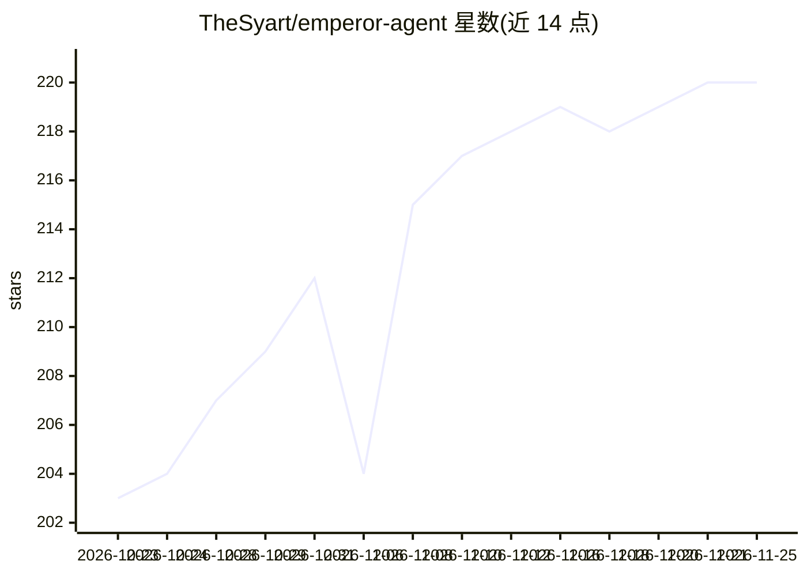

# TheSyart/emperor-agent

⭐ 220 · TypeScript · MIT · 推送 2026-11-23 · [GitHub](https://github.com/TheSyart/emperor-agent) · [官网](https://github.com/TheSyart/emperor-agent) · 个人维护 · 中文 README

**面向个人用户的本地桌面 AI Agent 工作台**

Electron 桌面应用，提供 Chat（普通对话）与 Build（绑定本地项目目录）两类会话，Agent 可按权限预设读取文件、运行工具并持续推进任务。机制上包含先规划再执行的计划模式、自动续跑的目标（默认 256 轮上限）、定时任务、本地子智能体及可接入的 Claude Code/Codex CLI，支持 Skill、Plugin、MCP 与记忆分层存储。数据与 API Key 加密保存于本机，无遥测。限制：仅支持 macOS，安装包未签名，不提供多人服务端部署。

## 筛选速览

| 维度 | 判定 | 备注 |
|---|---|---|
| AI 角色 | `ai-native` | 本体是模型或模型工具 |
| 许可风险 | `permissive` | MIT |
| 部署形态 | `desktop` | 安装包/桌面程序 |
| 模型依赖 | local-ok | 支持本地模型 |
| 硬件要求 | — | 无带数字的原话,不猜 |
| 安装摩擦 | `low` | 无编译、无系统依赖或容器化 |
| 成熟度 | — | 结构信号不足 |

## 能力要点

- Chat/Build 双会话模式与三级权限预设（read-only/workspace-write/danger-full-access）
- 计划模式先只读探索再批准执行；目标模式自动续跑长任务
- 支持本地 Skill、版本化 Plugin、MCP server 接入与分层记忆
- macOS Shell（Seatbelt）沙箱执行与受保护路径表

## 适用场景

- 日常问答与资料整理
- 绑定本地项目让 Agent 在权限范围内完成代码与文档任务
- 设置目标让 Agent 自动多轮推进到完成
- 接入 MCP server 和 Skill 扩展工具能力

## 场景标签

`AI 助手` · 领域:对话与助手

## 证据(README 行号)

> L8: Emperor Agent 是一款面向个人长期使用的桌面 Agent。你可以用它处理日常问答，也可以绑定本地项目，让 Agent 在明确的权限范围内读取文件、运行工具并持续推进任务。
> L51: 「设置 › 模型」按供应商分组保存多个模型：添加时 Emperor 先测试连接、读取厂商的模型列表，再按厂商接口与内置目录预填上下文、每次输出和思考强度；API Key 加密保存。当前使用哪个模型在聊天输入框中选择，切换从下一次请

## 星数曲线

2026-10-23 203 → 2026-11-25 220（+17）

---
*卡片 v1 · prompt 1.4 · 生成 2026-11-25 · 置信度 high · 依据 README sha `3be7830f0580` · [字段定义](../../DATASET.md)*
