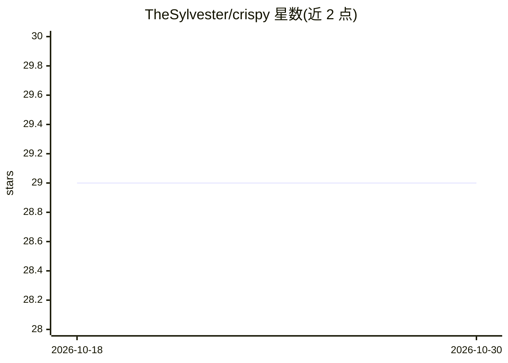

# TheSylvester/crispy

⭐ 29 · TypeScript · MIT · 推送 2026-05-11 · [GitHub](https://github.com/TheSylvester/crispy) · [官网](https://github.com/TheSylvester/crispy) · 个人维护

**Claude Code 与 Codex 的多标签 GUI 工作台，含多 agent 编排**

面向使用 Claude Code 与 Codex CLI 的开发者的多标签 agent 工作台：以 GUI 并行管理多个 agent 会话，提供 /superthink 对抗式验证（让 Claude 与 Codex 回答同一问题后收敛）、本地全文+语义检索的 agent 记忆（自动回填既有转录）、任意消息处 fork/rewind、工具审计面板、Discord 远程监控与审批、语音输入。支持会话中途切换厂商、自定义 Anthropic 兼容 provider。可作 VS Code/Cursor 扩展、npm 独立模式或 Tauri Windows 原生应用运行；依赖 Node.js 18+ 与对应 CLI。

## 筛选速览

| 维度 | 判定 | 备注 |
|---|---|---|
| AI 角色 | `ai-ecosystem` | LLM/agent 周边工具 |
| 许可风险 | `permissive` | MIT |
| 部署形态 | `library` | 以包/库形式分发 |
| 模型依赖 | — | README 未给出锁定关系 |
| 硬件要求 | — | 无带数字的原话,不猜 |
| 安装摩擦 | `low` | 无编译、无系统依赖或容器化 |
| 成熟度 | — | 结构信号不足 |

## 能力要点

- /superthink 让 Claude 与 Codex 对同一问题互验并收敛出统一结论
- 全部会话转录本地索引，支持全文与语义检索并自动回填历史
- Discord 远程：实时会话监控与手机端内联审批工具调用
- 多标签工作台：fork/rewind、工具审计面板、厂商中途切换

## 适用场景

- 同时管理多个 Claude Code / Codex 会话并观察子 agent 工作过程
- 通过 Discord 在手机上监控会话并审批工具使用
- 跨历史会话检索过往决策与调试线索
- 让两个模型对抗验证同一段代码或方案

## 场景标签

`Agent 记忆` `多智能体` `编码 Agent` · 领域:Agent 开发

## 证据(README 行号)

> L3: **A GUI for Claude Code and Codex, built for multi-agent orchestration — with 'superthink' adversarial verification,
> L15: - **/superthink** — pit Claude and Codex against each other on the same question. Catches bugs and blind spots a si
> L144: - Run `npm i -g crispy-code && crispy` — full UI in your browser, no VS Code required

## 星数曲线

2026-10-18 29 → 2026-10-30 29（+0）

---
*卡片 v1 · prompt 1.4 · 生成 2026-10-26 · 置信度 high · 依据 README sha `d7b9e75fae10` · [字段定义](../../DATASET.md)*
