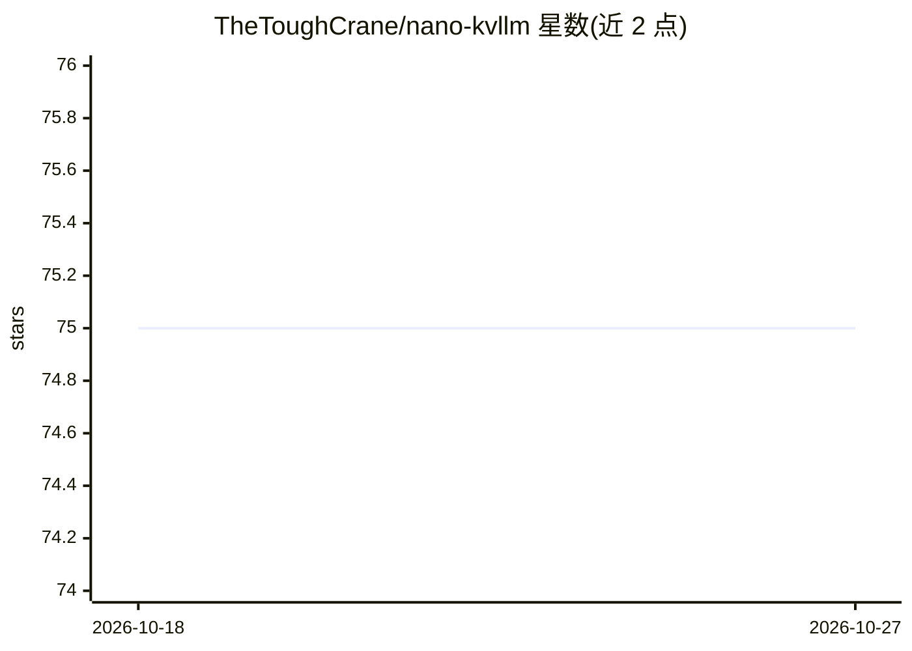

# TheToughCrane/nano-kvllm

⭐ 75 · Python · MIT · 推送 2026-04-24 · [GitHub](https://github.com/TheToughCrane/nano-kvllm) · 个人维护

**面向 LLM 推理的 KV-cache 压缩研究与开发框架**

构建于 nano-vllm 之上的 LLM 推理框架，聚焦 KV-cache 内存管理：v0.2.0 实现基于窗口+周期触发机制的 KV-cache 压缩，全局按固定解码步数触发，对 Top-K 序列的末尾未压缩块做压缩，以缓解高并发与长上下文生成场景的显存瓶颈。附带应用层演示 KvChat，提供单用户多轮对话 CLI，可在对话中开关压缩并调节参数。供开发者在批量推理服务中提升吞吐、快速实现与验证 KV-cache 压缩算法。实验报告 Math500 上吞吐提升 10%（2000→2200 tok/s）。

## 筛选速览

| 维度 | 判定 | 备注 |
|---|---|---|
| AI 角色 | `ai-ecosystem` | LLM/agent 周边工具 |
| 许可风险 | `permissive` | MIT |
| 部署形态 | `None` |  |
| 模型依赖 | — | README 未给出锁定关系 |
| 硬件要求 | — | 无带数字的原话,不猜 |
| 安装摩擦 | `low` | 无编译、无系统依赖或容器化 |
| 成熟度 | — | 结构信号不足 |

## 能力要点

- 窗口+周期的 KV-cache 压缩机制，仅压缩未压缩块
- KvChat 单用户多轮对话演示，支持运行时开关压缩与调参
- 支持张量并行多 GPU 推理与图友好解码路径
- 实验报告高并发场景吞吐提升 10%

## 适用场景

- 在长上下文高并发推理中缓解 KV-cache 显存瓶颈
- 实现并快速验证自己的 KV-cache 压缩算法
- 通过 KvChat 体验在线 KV-cache 压缩的多轮对话

## 场景标签

`推理引擎` · 领域:训练与推理

## 证据(README 行号)

> L7: **KvLLM** is an **AI/LLM inference framework** built on top of `nano-vllm`, focused on efficient KV-cache memory man
> L102: `nano-kvllm` is the **development framework** behind **KvLLM**.
> L108: 2. **Implement and rapidly validate KV-cache compression algorithms**

## 星数曲线

2026-10-18 75 → 2026-10-27 75（+0）

---
*卡片 v1 · prompt 1.4 · 生成 2026-10-24 · 置信度 high · 依据 README sha `e6ec50a491d6` · [字段定义](../../DATASET.md)*
