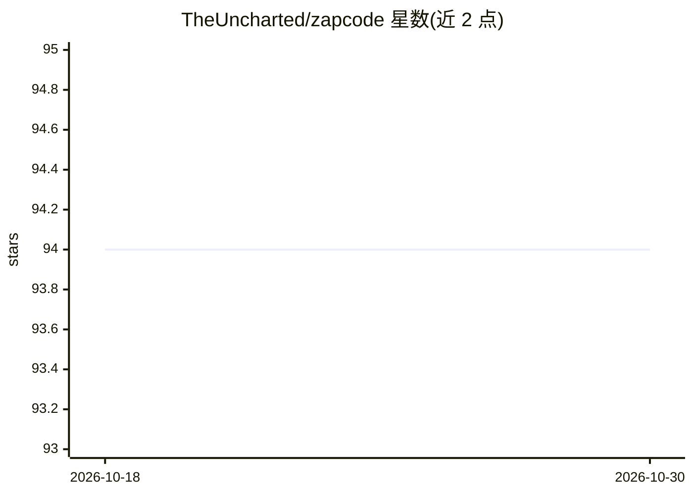

# TheUncharted/zapcode

⭐ 94 · Rust · MIT · 推送 2026-08-29 · [GitHub](https://github.com/TheUncharted/zapcode) · 组织维护

**供 AI agent 安全执行 TypeScript 代码的 Rust 解释器与沙箱**

用 Rust 编写的可嵌入 TypeScript 子集解释器，面向 AI agent 的代码执行场景：LLM 写 TypeScript 代码调用工具，Zapcode 在语言级沙箱中执行，工具调用时挂起 VM 并生成快照，宿主侧解析后恢复。冷启动约 2µs，快照小于 2KB，支持内存/时间/栈深/分配次数资源限制，核心 crate 零 unsafe，附 65 项对抗测试。提供 npm/PyPI/crates.io/WASM 多语言接入，内置 Vercel AI SDK 与 Anthropic SDK 适配器及自定义适配器机制。限制：不执行正则、不支持 npm 包与完整 Node.js 标准库，声明为实验性项目。

## 筛选速览

| 维度 | 判定 | 备注 |
|---|---|---|
| AI 角色 | `ai-ecosystem` | LLM/agent 周边工具 |
| 许可风险 | `permissive` | MIT |
| 部署形态 | `library` | 以包/库形式分发 |
| 模型依赖 | — | README 未给出锁定关系 |
| 硬件要求 | — | 无带数字的原话,不猜 |
| 安装摩擦 | `low` | 无编译、无系统依赖或容器化 |
| 成熟度 | `idea` | |

## 能力要点

- 语言级沙箱：解析期阻断 import/require/eval，无文件系统、网络与环境访问
- 执行状态可快照为字节并跨进程/机器恢复
- 约 2µs 冷启动，单次执行内存约 10KB
- 提供 Vercel AI SDK / Anthropic SDK 适配器与自定义 Adapter 机制

## 适用场景

- 让 AI agent 以写代码替代链式工具调用并安全执行
- agent 循环中执行大量小代码片段而避免容器冷启动开销
- 在 Node.js/Python/Rust/WASM 宿主中嵌入沙箱代码执行能力

## 场景标签

`Agent 框架` · 领域:Agent 开发

## 证据(README 行号)

> L28: Zapcode takes a different approach: a purpose-built TypeScript interpreter that starts in **2 microseconds**, enfor
> L168: Under the hood: the LLM writes TypeScript code that calls your tools → Zapcode executes it in a sandbox → tool cal

## 星数曲线

2026-10-18 94 → 2026-10-30 94（+0）

---
*卡片 v1 · prompt 1.4 · 生成 2026-10-23 · 置信度 high · 依据 README sha `653d02372968` · [字段定义](../../DATASET.md)*
