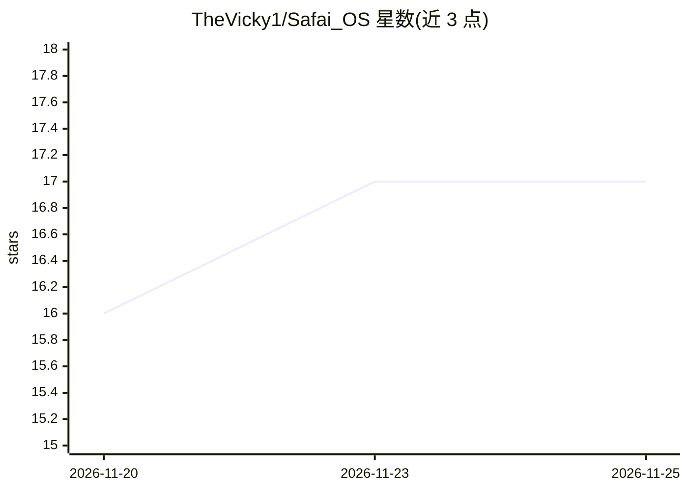

# TheVicky1/Safai_OS

⭐ 17 · Python · MIT · 推送 2026-11-23 · [GitHub](https://github.com/TheVicky1/Safai_OS) · 个人维护

**市政垃圾事件检测与处置闭环的运营系统**

面向市民、清运司机与市政管理者的开源市政垃圾治理系统：用 YOLO11s 模型对街面垃圾做定位与 5 类材质分类，事件经确定性派单分配给司机，处置需前后照片证据并经市民或管理员双重核验，核验通过后按幂等规则发放 Safai Coins 积分。数据层为 PostgreSQL 17/Supabase，全部 16 张表启用 RLS，客户端仅作展示层，状态变更须经服务器校验，并维护只追加的审计日志。

## 筛选速览

| 维度 | 判定 | 备注 |
|---|---|---|
| AI 角色 | `ai-native` | 本体是模型或模型工具 |
| 许可风险 | `permissive` | MIT |
| 部署形态 | `None` |  |
| 模型依赖 | — | README 未给出锁定关系 |
| 硬件要求 | — | 无带数字的原话,不猜 |
| 安装摩擦 | `low` | 无编译、无系统依赖或容器化 |
| 成熟度 | — | 结构信号不足 |

## 能力要点

- YOLO11s 768px 检测引擎，输出 5 类材质分类并使用类内 NMS
- 自建 10,000+ 张审计图像数据集 SafaiOS_Dataset_v10k，声称零跨分割泄漏
- 双角色处置核验（citizen/driver/admin）与 7 天未响应自动升级机制
- 16 张表 100% 覆盖 RLS、只追加账本与幂等积分发放

## 适用场景

- 市民拍照上报露天垃圾堆并核验清理结果
- 市政部门派单、追踪清运任务并留存审计记录
- 司机接收任务、提交前后对比清理证据并获积分

## 场景标签

`目标检测` `工作流自动化` · 领域:效率与自动化

## 证据(README 行号)

> L30: SafaiOS is an open-source, server-authoritative **Civic Waste Intelligence & Municipal Operating System**. Built on
> L32: 1. **Instant AI Detection**: High-resolution waste localization and classification across five material categories.
> L61: |**YOLO11s Detection Engine**|Real-time object detection at 768px (`E002` baseline & `E004` CoarseDropout) classify

## 星数曲线

2026-11-20 16 → 2026-11-25 17（+1）

---
*卡片 v1 · prompt 1.4 · 生成 2026-11-20 · 置信度 high · 依据 README sha `8473b0a8310b` · [字段定义](../../DATASET.md)*
