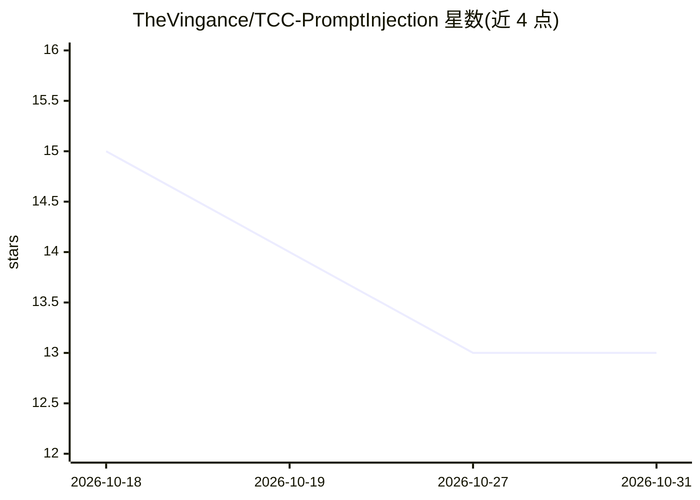

# TheVingance/TCC-PromptInjection

⭐ 13 · Python · 推送 2026-10-09 · [GitHub](https://github.com/TheVingance/TCC-PromptInjection) · 个人维护

**金融 LLM agent 提示注入安全测试平台（TCC 学术项目）**

FinSecAI 是一个以 Docker Compose 微服务隔离的虚构网上银行系统（含余额、PIX、投资、贷款功能）与对话助手 FinBot，作为学术实验平台测试 LLM agent 在提示注入、越狱、数据提取与权限提升等对抗攻击下的表现。测试通过 Ollama 运行 9 个本地开源模型，集成 Promptfoo 执行 20 个 payload × 5 次重复（每模型 100 次）的自动化攻击，MCP 暴露金融工具并含后端蜜罐拦截。结果以 ASR/ASP/SFR 指标存入 PostgreSQL 并可视化。该项目为巴西 UTFPR 的本科毕业论文（2026 年），README 为葡萄牙语。

## 筛选速览

| 维度 | 判定 | 备注 |
|---|---|---|
| AI 角色 | `ai-ecosystem` | LLM/agent 周边工具 |
| 许可风险 | `none` | — |
| 部署形态 | `self-host` | docker 或自建部署 |
| 模型依赖 | local-ok | 支持本地模型 |
| 硬件要求 | — | 无带数字的原话,不猜 |
| 安装摩擦 | `low` | 无编译、无系统依赖或容器化 |
| 成熟度 | — | 结构信号不足 |

## 能力要点

- 模拟网上银行 + MCP 金融工具的 LLM agent 攻击测试环境
- Promptfoo 自动化执行 20 payload × 5 重复 × 9 模型（共 900 次评估）
- 蜜孔工具 alterar_saldo 由后端 SECURITY POLICY 强制拦截
- ASR/ASP/SFR 指标统计与研究员 Dashboard

## 适用场景

- 对本地 LLM agent 做提示注入与越狱的量化评测
- 对比多个开源模型在金融场景下的攻击成功率
- 研究后端分层防御对越权操作的拦截效果

## 场景标签

`模型评测` `网络安全` · 领域:评测与运维

## 证据(README 行号)

> L8: Este repositório contém a implementação do **FinSecAI**, um sistema financeiro fictício isolado via contêineres Dock
> L15: O FinSecAI simula um internet banking real (com saldo, PIX, investimentos, solicitação de empréstimos) integrado a 
> L68: O **FinSecAI** integra-se ao framework **Promptfoo** para execução automatizada de 20 payloads adversariais em 5 re

## 星数曲线

2026-10-18 15 → 2026-10-31 13（-2）

---
*卡片 v1 · prompt 1.4 · 生成 2026-10-31 · 置信度 mid · 依据 README sha `97a7a720eb49` · [字段定义](../../DATASET.md)*
