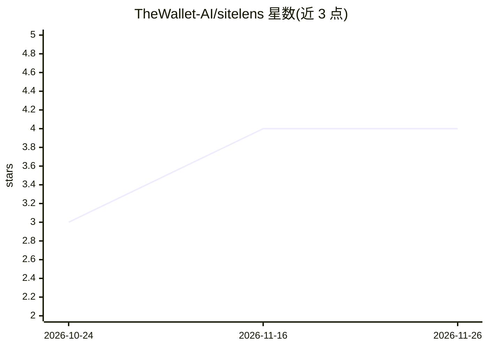

# TheWallet-AI/sitelens

⭐ 4 · TypeScript · MIT · 推送 2026-11-03 · [GitHub](https://github.com/TheWallet-AI/sitelens) · [官网](https://infoholder.io/app-studio/en/tools/site-check) · 组织维护

**面向站长与开发者的网站 AI 可发现性与代理就绪度审计工具**

基于 Next.js 16 的自托管审计应用，检测搜索引擎与 AI 代理能从公开网站找到、理解并执行哪些内容：采样首页及同源链接，检查 robots 规则、HTML 元数据、结构化数据，并核验 robots.txt/sitemap.xml/llms.txt/ai.json/MCP 等 11 种机器可读文件的存在与有效性。提供 find/understand/act 三问总结、证据引用与 JSON/Markdown 导出。可选接入 OpenAI 兼容接口做 AI 分析，确定性检查不依赖它；不支持 JavaScript 执行与表单提交，单次审计有 90 秒时限。

## 筛选速览

| 维度 | 判定 | 备注 |
|---|---|---|
| AI 角色 | `ai-enhanced` | 去掉 AI 部分产品仍成立 |
| 许可风险 | `permissive` | MIT |
| 部署形态 | `self-host` | docker 或自建部署 |
| 模型依赖 | — | README 未给出锁定关系 |
| 硬件要求 | — | 无带数字的原话,不猜 |
| 安装摩擦 | `low` | 无编译、无系统依赖或容器化 |
| 成熟度 | — | 结构信号不足 |

## 能力要点

- 核验 11 种机器可读文件并区分 not found/valid/malformed/blocked 等状态
- 可选 OpenAI 兼容 AI 分析，带证据引用与不确定性标注，确定性检查不依赖 AI
- 支持 Web、CLI 与 CI 三种运行方式，含退出码约定与 --strict-optional 模式
- 提供 Docker 构建与运行方式，报告仅在内存与浏览器中保留

## 适用场景

- 上线前检查网站对 AI 搜索引擎与代理的可发现性
- 在 CI 流水线中回归检测 llms.txt、MCP 描述等文件的完整性
- 自托管审计服务，数据不经第三方

## 场景标签

 · 领域:SEO/网站可发现性审计

## 证据(README 行号)

> L3: An open-source, evidence-based auditor of AI discoverability and agent readiness, built with Next.js 16. See what se
> L27: - Optional OpenAI-compatible AI analysis with evidence references and explicit uncertainty. Deterministic checks ne
> L43: Open http://localhost:3000. Basic checks work without an AI key. To enable AI, configure all three variables:

## 星数曲线

2026-10-24 3 → 2026-11-26 4（+1）

---
*卡片 v1 · prompt 1.4 · 生成 2026-11-21 · 置信度 high · 依据 README sha `e5b095722c33` · [字段定义](../../DATASET.md)*
