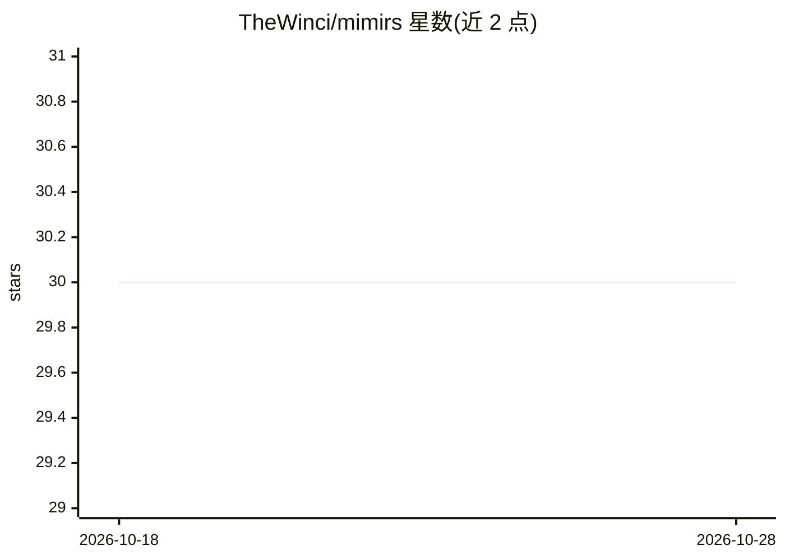

# TheWinci/mimirs

⭐ 30 · TypeScript · Apache-2.0 · 推送 2026-10-19 · [GitHub](https://github.com/TheWinci/mimirs) · 个人维护

**本地 MCP 服务器：给 AI 编程助手提供代码库的持久化可检索记忆**

面向 AI 编程 agent 的本地记忆服务：以 MCP server 形式（stdio）接入 Claude Code、Cursor、Windsurf、Copilot、JetBrains 等客户端。它对代码库做 AST 感知分块（24 种语言）、向量+BM25 混合检索并按依赖图中心性加权，提供 search、read_relevant、project_map、对话检索、标注等工具，并含自动生成的 wiki、跨会话对话记忆与 checkpoint。完全本地运行，依赖 Bun 与 SQLite，无需 API key、云服务或 Docker；另可作 Claude Code 插件安装，附带 11 个工作流技能。

## 筛选速览

| 维度 | 判定 | 备注 |
|---|---|---|
| AI 角色 | `ai-ecosystem` | LLM/agent 周边工具 |
| 许可风险 | `permissive` | Apache-2.0 |
| 部署形态 | `self-host` | docker 或自建部署 |
| 模型依赖 | — | README 未给出锁定关系 |
| 硬件要求 | — | 无带数字的原话,不猜 |
| 安装摩擦 | `low` | 无编译、无系统依赖或容器化 |
| 成熟度 | — | 结构信号不足 |

## 能力要点

- AST 感知分块（24 种语言）+ 向量/BM25 混合检索 + 依赖图加权
- 跨会话对话记忆与自动 checkpoint
- 自动生成项目 wiki
- 完全本地运行，无需 API key、云服务或 Docker

## 适用场景

- 让编程 agent 跨会话记住代码库结构与昨日讨论内容
- 在大型代码库中用语义检索定位相关代码，减少 token 消耗
- 编辑代码后自动重建索引并找到受影响的测试

## 场景标签

`Agent 记忆` `语义搜索` · 领域:Agent 开发

## 证据(README 行号)

> L4:  Persistent project memory for AI coding agents. One command to set up, nothing to maintain.
> L52: The mimirs MCP server runs over stdio. Every client needs the same three things: a `command` (`bunx`), `args` (`["m
> L24:  Works with: Claude Code &nbsp;·&nbsp; Cursor &nbsp;·&nbsp; Windsurf &nbsp;·&nbsp; JetBrains (Junie) &nbsp;·&nbsp; 

## 星数曲线

2026-10-18 30 → 2026-10-28 30（+0）

---
*卡片 v1 · prompt 1.4 · 生成 2026-10-26 · 置信度 mid · 依据 README sha `02e8cc55e572` · [字段定义](../../DATASET.md)*
