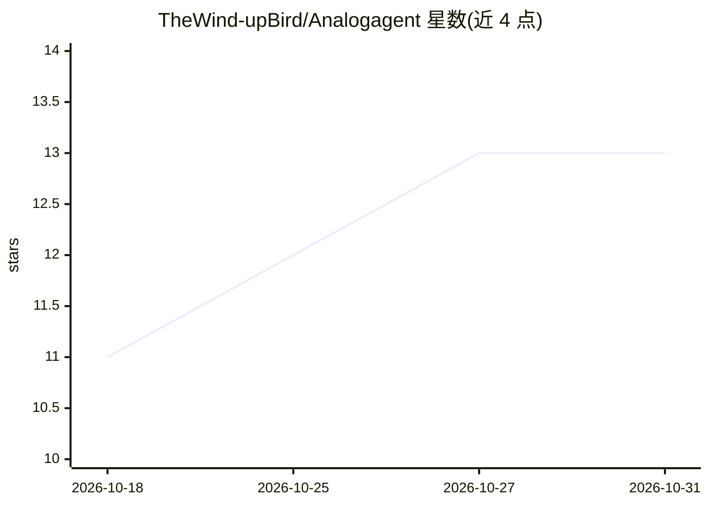

# TheWind-upBird/Analogagent

⭐ 13 · Python · MIT · 推送 2026-06-08 · [GitHub](https://github.com/TheWind-upBird/Analogagent) · [官网](https://arxiv.org/abs/2603.23910) · 组织维护

**LLM 多智能体驱动的模拟电路设计自动化框架**

KDD 2026（AI4Science, Oral）论文配套实现：用多智能体系统执行模拟电路设计的端到端精炼循环（生成→执行/检查→优化→规则整理），通过 Code Generator 与 Design Optimizer 等角色分工协作；Self-Evolving Memory 负责设计启发式规则的过滤、冲突检查、去重与持久化，实现跨任务知识复用。运行需 Ubuntu 20.04、Python 3.10、ngspice 与 PySpice，支持 vLLM 本地推理或 Gemini/GPT/Qwen 云端 API。当前仓库为 MVP 版本。

## 筛选速览

| 维度 | 判定 | 备注 |
|---|---|---|
| AI 角色 | `ai-ecosystem` | LLM/agent 周边工具 |
| 许可风险 | `permissive` | MIT |
| 部署形态 | `None` |  |
| 模型依赖 | local-ok | 支持本地模型 |
| 硬件要求 | — | 无带数字的原话,不猜 |
| 安装摩擦 | `medium` | 含编译或系统依赖之一 |
| 成熟度 | `idea` | |

## 能力要点

- 端到端精炼循环：生成→执行/检查→优化→规则整理
- Self-Evolving Memory 实现规则去重、冲突检查与持久化
- 支持 vLLM 本地推理与 Gemini/GPT/Qwen 云端 API
- 附基准任务集 problem_set.tsv（标准化模拟电路设计规格）

## 适用场景

- 自动化完成模拟电路设计与仿真精炼
- 复现 KDD 2026 论文的实验结果
- 跨设计任务复用积累的电路设计启发式规则

## 场景标签

`多智能体` `Agent 记忆` · 领域:Agent 开发

## 证据(README 行号)

> L5: This repository contains the implementation of AnalogAgent, an agentic framework for automated analog circuit design
> L13: - Multi-Agent Systems for execution-driven refinement

## 星数曲线

2026-10-18 11 → 2026-10-31 13（+2）

---
*卡片 v1 · prompt 1.4 · 生成 2026-10-31 · 置信度 high · 依据 README sha `5dcabe79060c` · [字段定义](../../DATASET.md)*
