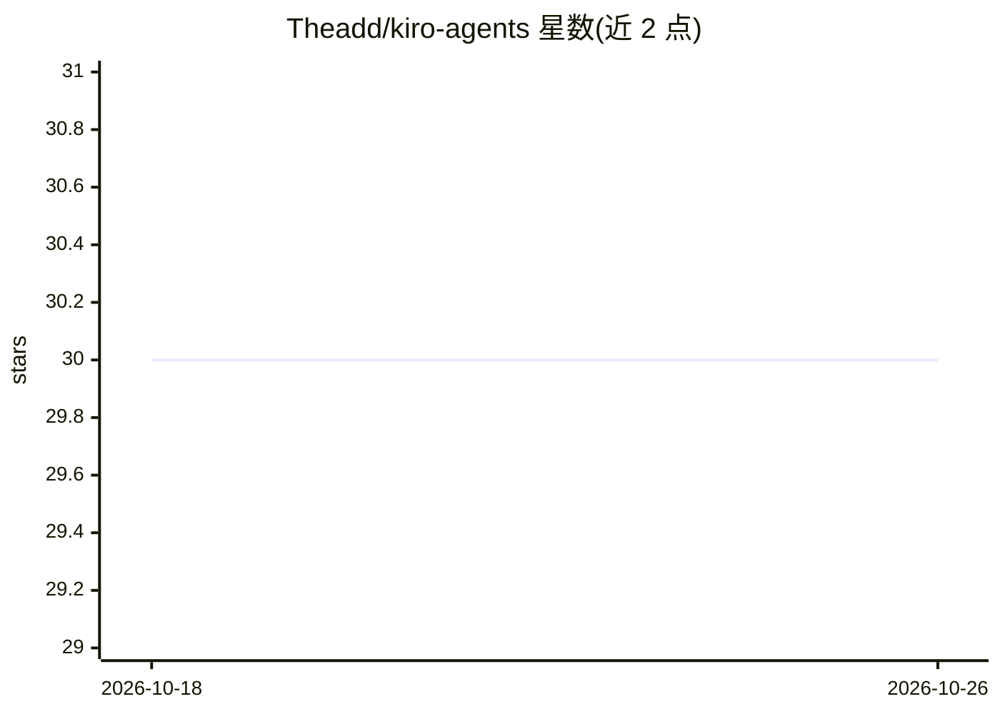

# Theadd/kiro-agents

⭐ 30 · TypeScript · NOASSERTION · 推送 2026-04-20 · [GitHub](https://github.com/Theadd/kiro-agents) · 个人维护

**Kiro IDE 的 AI agent 创建与管理系统**

面向 Kiro IDE 用户的 agent 体系：通过模板、角色库、自然语言描述或向导四种方式创建各领域自定义 agent；首次使用自动生成管理型 agent kiro-master 用于持续改进。支持 vibe（对话式）与 spec（结构化）两种交互模式切换、严格模式与基于持久记忆的反思系统。本体为纯 markdown 指令文件（无代码、无额外依赖），协议按需加载，基础上下文占用 1.35K token；产物保存于 .kiro/kiro-agents/ 下可版本管理。

## 筛选速览

| 维度 | 判定 | 备注 |
|---|---|---|
| AI 角色 | `ai-ecosystem` | LLM/agent 周边工具 |
| 许可风险 | `none` | NOASSERTION |
| 部署形态 | `library` | 以包/库形式分发 |
| 模型依赖 | — | README 未给出锁定关系 |
| 硬件要求 | — | 无带数字的原话,不猜 |
| 安装摩擦 | `low` | 无编译、无系统依赖或容器化 |
| 成熟度 | — | 结构信号不足 |

## 能力要点

- 模板/角色库/自然语言/向导四种 agent 创建方式
- vibe 与 spec 交互模式切换及严格模式
- kiro-master 管理 agent 持续改进，反思系统跨会话记忆
- 纯 markdown 实现，基础上下文 1.35K，协议按需加载

## 适用场景

- 在 Kiro IDE 中按领域定制专属 AI agent
- 用自然语言快速生成代码库相关的项目级 agent
- 在对话式与结构化工作流间切换开发方式

## 场景标签

`提示工程` · 领域:Agent 开发

## 证据(README 行号)

> L3: AI agent system for Kiro IDE. Create custom AI agents tailored to your exact needs—easily and interactively, with mi
> L5: Build agents for any domain: development, design, business, research, or anything else. Choose from templates, explo

## 星数曲线

2026-10-18 30 → 2026-10-26 30（+0）

---
*卡片 v1 · prompt 1.4 · 生成 2026-10-26 · 置信度 high · 依据 README sha `49440d16c7b6` · [字段定义](../../DATASET.md)*
