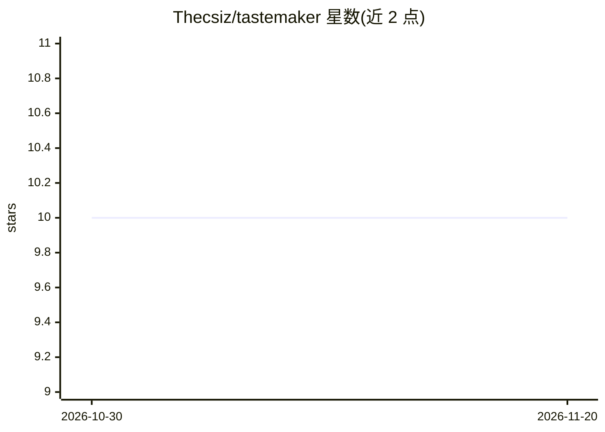

# Thecsiz/tastemaker

⭐ 10 · HTML · NOASSERTION · 推送 2026-10-28 · [GitHub](https://github.com/Thecsiz/tastemaker) · [官网](https://thecsiz.github.io/tastemaker/) · 个人维护

**给 Claude Code/Codex 用的设计评审 skill：批判工艺与品味**

以 Claude Code 和 Codex 的 skill 形式分发的设计评审工具：输入截图、Figma 文件或在线页面，按固定流程输出评审——先设定 brief，再按 20 条 craft 规则检查、12 条品味原则判断、5 条排序权衡裁决冲突，最后给出分级与改进建议。附带 scope 模式（对功能清单给出 Keep/Cut/Defer/Merge/Move 判定）和 system 模式（跨屏一致性检查）。知识库随 skill 打包，每条发现须引用真实条目 ID。通过 git clone 复制到本地 skills 目录安装，HTML 报告生成需要 Node。

## 筛选速览

| 维度 | 判定 | 备注 |
|---|---|---|
| AI 角色 | `ai-knowledge` | 知识聚合/清单类 |
| 许可风险 | `none` | NOASSERTION |
| 部署形态 | `None` |  |
| 模型依赖 | — | README 未给出锁定关系 |
| 硬件要求 | — | 无带数字的原话,不猜 |
| 安装摩擦 | `low` | 无编译、无系统依赖或容器化 |
| 成熟度 | — | 结构信号不足 |

## 能力要点

- 37 条知识库条目：20 条 craft 规则、12 条品味原则、5 条排序权衡
- 每条发现必须引用真实知识库 ID，无匹配时声明无 ID
- scope 模式对功能清单输出 Keep/Cut/Defer/Merge/Move 表格
- 支持项目级自定义排序文件 tastemaker-house.md 与削减记录 tastemaker-cuts.md

## 适用场景

- 开发前让 skill 评审 PRD/功能清单决定砍掉哪些功能
- 对截图或在线页面获取工艺与品味评分及修改建议
- 跨 Figma 多帧检查产品级设计原则一致性
- 把评审结果写入 Figma 文件卡片或生成本地 HTML 报告

## 场景标签

`编码 Agent` `代码审查` · 领域:编码与开发

## 证据(README 行号)

> L3: Tastemaker is a design-critique skill for Claude Code and Codex. You give it a screenshot, a Figma file or a live pa

## 星数曲线

2026-10-30 10 → 2026-11-20 10（+0）

---
*卡片 v1 · prompt 1.4 · 生成 2026-11-20 · 置信度 high · 依据 README sha `7ee1a2950b75` · [字段定义](../../DATASET.md)*
