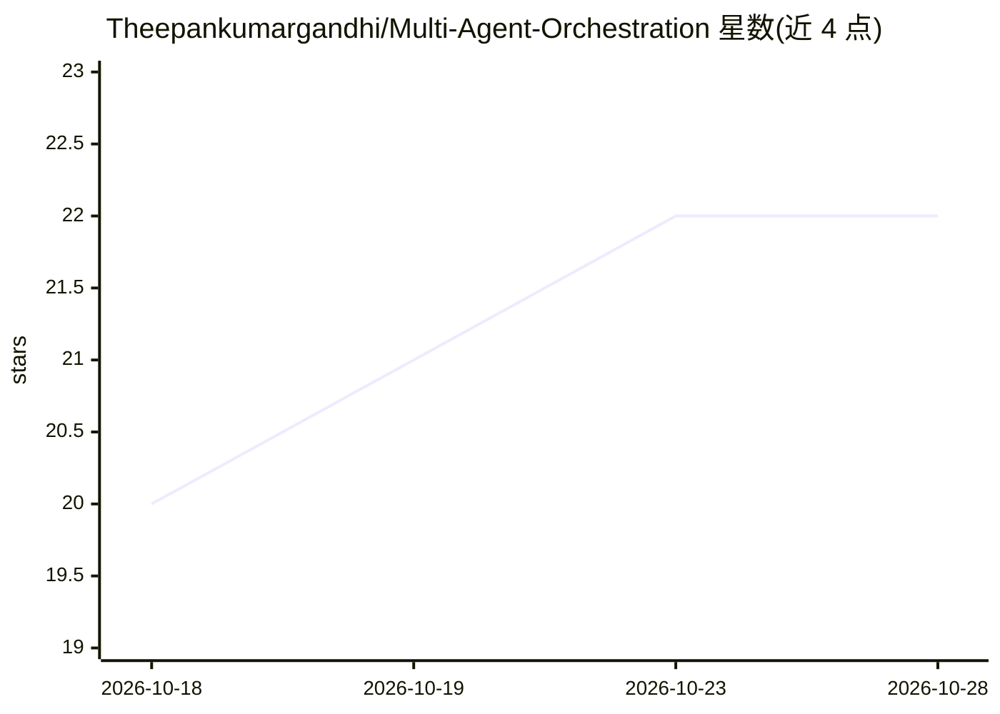

# Theepankumargandhi/Multi-Agent-Orchestration

⭐ 23 · Python · MIT · 推送 2026-10-28 · [GitHub](https://github.com/Theepankumargandhi/Multi-Agent-Orchestration) · 个人维护

**带证据核验的文档/网页问答研究助手（CiteRight）**

面向需要可溯源回答的用户：读取 PDF/Markdown 建立混合检索（向量+BM25 融合重排），回答前由确定性 grounding 校验器逐条比对接证据，删除无支撑或与来源矛盾的声明，无证据时拒答。问答流经 17 节点的 LangGraph 状态机，含安全检查、网页搜索人工审批、计算器路由与每用户会话持久化；由 FastAPI 后端与 React 前端组成，支持 Docker Compose 部署。需 Groq 或 OpenAI API key，本地嵌入为默认。校验器为启发式而非蕴含模型，存在已知漏检（L120-124）。

## 筛选速览

| 维度 | 判定 | 备注 |
|---|---|---|
| AI 角色 | `ai-native` | 本体是模型或模型工具 |
| 许可风险 | `permissive` | MIT |
| 部署形态 | `self-host` | docker 或自建部署 |
| 模型依赖 | locked-api |  |
| 硬件要求 | — | 无带数字的原话,不猜 |
| 安装摩擦 | `low` | 无编译、无系统依赖或容器化 |
| 成熟度 | — | 结构信号不足 |

## 能力要点

- grounding 校验器：逐声明映射证据、拒绝未检索到的引用、检测矛盾后释放/修复/弃答
- 混合检索（向量+BM25 融合重排）带来源与章节引用
- 网页搜索前人工审批（HITL），算术走计算器不走 LLM
- CI 离线质量门（路由≥95%、grounding 14 例、证据质量、记忆隔离）

## 适用场景

- 用我自己的 PDF/Markdown 文档做带引用的问答
- 要求每个回答都有来源、拦截编造引用
- 对时效性问题先审批再联网检索

## 场景标签

`文档问答` `RAG` `多智能体` · 领域:Agent 开发

## 证据(README 行号)

> L9: CiteRight checks the answer before you see it. Every factual claim is matched against the evidence
> L19: - **Checks every answer.** A grounding verifier maps each claim to evidence, rejects citations to
> L33:                        → draft answer → grounding check → release / repair / abstain

## 星数曲线

2026-10-18 20 → 2026-10-28 22（+2）

---
*卡片 v1 · prompt 1.4 · 生成 2026-10-27 · 置信度 high · 依据 README sha `ecc1fe02727d` · [字段定义](../../DATASET.md)*
