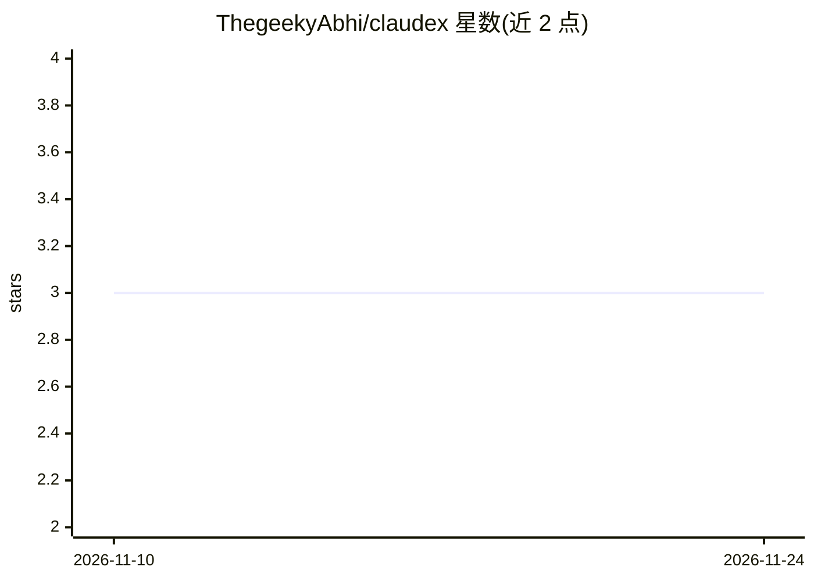

# ThegeekyAbhi/claudex

⭐ 3 · TypeScript · MIT · 推送 2026-11-23 · [GitHub](https://github.com/ThegeekyAbhi/claudex) · [官网](https://www.claudex.live/) · 个人维护

**在 VS Code 中同时使用 Claude Code 与 Codex 的工作区扩展**

一个 VS Code 扩展，把 Claude Code 与 Codex 两个 CLI 编码代理接入编辑器侧边栏：以现有 CLI 账户和配置运行，提供线程内切换代理并携带上下文、Markdown 计划评审后转入实现、今日待办页供代理读写、审批请求处理与 diff 查看等功能。支持多账户 profile、Git worktree 任务隔离、技能与 MCP 配置沿用。要求 VS Code 1.96+ 且已安装并登录对应 CLI；仅在 macOS 验证，无后端与遥测，会话本地存储。

## 筛选速览

| 维度 | 判定 | 备注 |
|---|---|---|
| AI 角色 | `ai-ecosystem` | LLM/agent 周边工具 |
| 许可风险 | `permissive` | MIT |
| 部署形态 | `None` |  |
| 模型依赖 | — | README 未给出锁定关系 |
| 硬件要求 | — | 无带数字的原话,不猜 |
| 安装摩擦 | `low` | 无编译、无系统依赖或容器化 |
| 成熟度 | — | 结构信号不足 |

## 能力要点

- 线程内切换 Claude Code / Codex 并保留上下文
- Markdown 计划评审与一键转入 Auto 实现
- 多账户 profile 与 Git worktree 任务隔离
- 本地运行未修改的 CLI，无后端与凭据存储

## 适用场景

- 在同一编辑器内交替使用两个编码代理并延续对话
- 先让代理出计划，评审后再开始实现
- 为个人和工作账户分别管理多个 CLI 登录

## 场景标签

`编码 Agent` · 领域:编码与开发

## 证据(README 行号)

> L1: # Claudex — Claude Code and Codex AI chat for VS Code
> L16: Requires Claude Code or Codex installed and signed in. Provider usage limits still apply. Developed and tested on m
> L136: Claudex runs your installed, unmodified CLIs. They keep their own authentication, settings, provider connections, 

## 星数曲线

2026-11-10 3 → 2026-11-24 3（+0）

---
*卡片 v1 · prompt 1.4 · 生成 2026-11-22 · 置信度 high · 依据 README sha `994018b472cf` · [字段定义](../../DATASET.md)*
