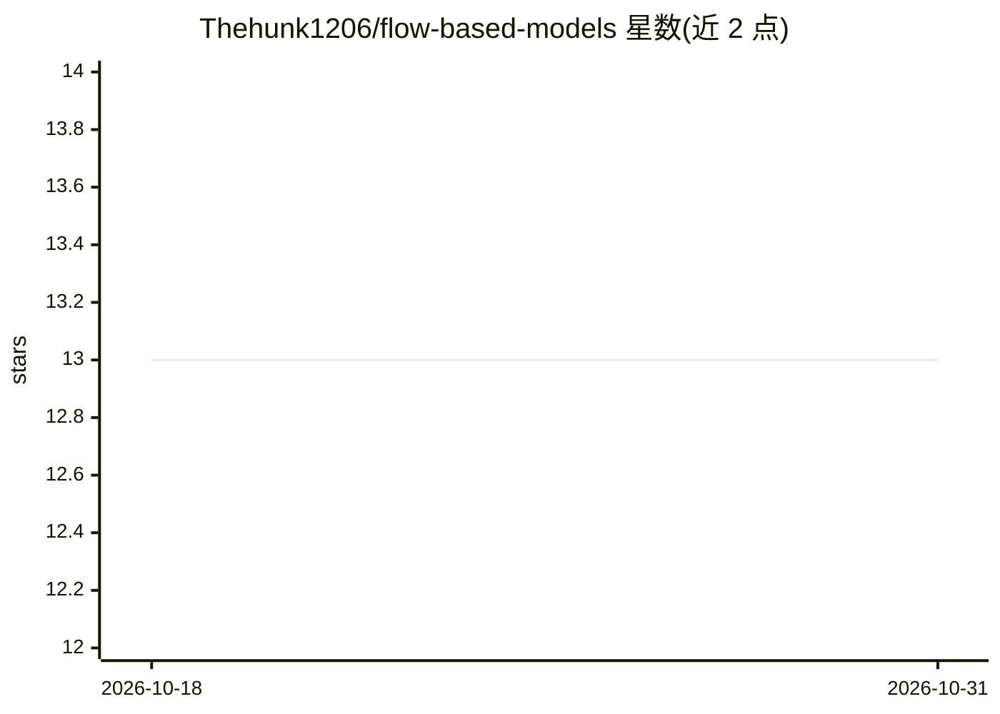

# Thehunk1206/flow-based-models

⭐ 13 · Python · MIT · 推送 2026-03-07 · [GitHub](https://github.com/Thehunk1206/flow-based-models) · 个人维护

**条件流匹配（CFM/OTCFM）图像生成训练框架**

实现 Conditional Flow Matching 的生成建模框架，包含最优传输条件流匹配（OTCFM）与独立条件流匹配（ICFM）两种模型，支持 Euler 与 Heun 采样求解器、EMA 权重跟踪与 TensorBoard 日志。面向使用 PyTorch 的研究人员与开发者，通过 train_cfm.py 训练、generate_samples.py 采样，另附 experiment_runner.sh 脚本用于自动化实验执行、中断恢复与进度跟踪。需 Python 3.8+，建议 CUDA 兼容 GPU。

## 筛选速览

| 维度 | 判定 | 备注 |
|---|---|---|
| AI 角色 | `ai-native` | 本体是模型或模型工具 |
| 许可风险 | `permissive` | MIT |
| 部署形态 | `None` |  |
| 模型依赖 | — | README 未给出锁定关系 |
| 硬件要求 | — | 无带数字的原话,不猜 |
| 安装摩擦 | `medium` | 含编译或系统依赖之一 |
| 成熟度 | — | 结构信号不足 |

## 能力要点

- OTCFM 与 ICFM 两种条件流匹配模型实现
- Euler/Heun 采样求解器与 EMA 权重跟踪
- experiment_runner.sh 支持实验自动执行、中断恢复与状态记录
- 生成时可保存网格图与中间步骤图像

## 适用场景

- 训练并对比 OTCFM/ICFM 生成模型
- 从 checkpoint 加载模型生成图像样本
- 批量运行并跟踪多组流匹配实验

## 场景标签

`图像生成` `模型训练` · 领域:内容生成

## 证据(README 行号)

> L4: This project implements Conditional Flow Matching (CFM) with a focus on Optimal Transport Conditional Flow Matching 
> L62: python generate_samples.py \

## 星数曲线

2026-10-18 13 → 2026-10-31 13（+0）

---
*卡片 v1 · prompt 1.4 · 生成 2026-10-31 · 置信度 high · 依据 README sha `d52e7c8b850e` · [字段定义](../../DATASET.md)*
