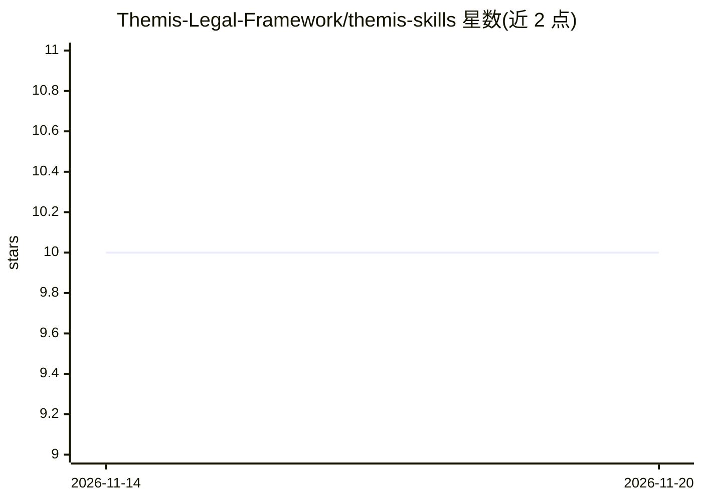

# Themis-Legal-Framework/themis-skills

⭐ 10 · MIT · 推送 2025-12-28 · [GitHub](https://github.com/Themis-Legal-Framework/themis-skills) · 组织维护

**面向诉讼律师的 AI 起草技能包：生成民事诉状等文书**

Themis Legal Framework 下的技能（skills）集合，由多个 SKILL.md 技能组成，覆盖起诉状起草、答辩与抗辩起草、提交前 QC 与风险审计等核心工作流。设计上以专家诉讼律师思维方式组织，强制约束包括不得虚构事实与案例引用（用 [CITE] 占位）、输出实际文书而非备忘录、以 [FLAG] 标注问题。默认输出为跨辖区通用格式，通过 Jurisdiction Pack 与 Style Pack 两类 overlay 应用本地辖区与文风要求。MIT 许可。

## 筛选速览

| 维度 | 判定 | 备注 |
|---|---|---|
| AI 角色 | `ai-knowledge` | 知识聚合/清单类 |
| 许可风险 | `permissive` | MIT |
| 部署形态 | `None` |  |
| 模型依赖 | — | README 未给出锁定关系 |
| 硬件要求 | — | 无带数字的原话,不猜 |
| 安装摩擦 | `low` | 无编译、无系统依赖或容器化 |
| 成熟度 | — | 结构信号不足 |

## 能力要点

- 核心技能：draft-complaint、draft-answer-and-defenses、pleading-qc-and-risk-audit
- 约束机制：禁止虚构事实与判例引用，使用 [CITE] 占位与 [FLAG] 内联标记
- 默认辖区无关输出，Jurisdiction/Style 两类 overlay 支持本地化
- 每个技能内含专家思维模型而非步骤清单

## 适用场景

- 起草民事起诉状并让 AI 检查要件与缺口
- 起草答辩状并逐段分析对方诉状的风险
- 提交前对诉状做 QC 与风险审计
- 结合辖区包适配本地格式与术语要求

## 场景标签

`AI 写作` · 领域:内容生成

## 证据(README 行号)

> L3: A skill stack for drafting civil litigation pleadings with AI. Built for the Themis Legal Framework.
> L29: ├── litigation-drafting-core     # Universal drafting workflow
> L104: skills/

## 星数曲线

2026-11-14 10 → 2026-11-20 10（+0）

---
*卡片 v1 · prompt 1.4 · 生成 2026-11-20 · 置信度 high · 依据 README sha `ec510cd18e9d` · [字段定义](../../DATASET.md)*
