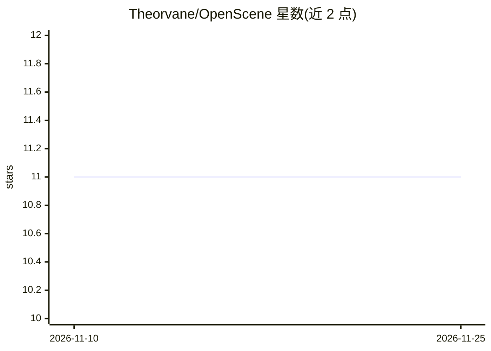

# Theorvane/OpenScene

⭐ 11 · TypeScript · MIT · 推送 2026-11-24 · [GitHub](https://github.com/Theorvane/OpenScene) · [官网](https://openscene.app) · 个人维护

**本地优先桌面视频剪辑器，AI Agent 可直接操作时间线**

Electron 桌面视频编辑器（另有共享同一编辑核心的 React Native 移动端）：以文件夹为项目，时间线剪辑、关键帧、转场、字幕样式，通过本地 FFmpeg 导出 H.264/AAC MP4。Edit Agent 通过类型化工具面调用与 UI 相同的操作——读取时间线、放置/裁剪素材、生成语音或视频、发起导出，一切写操作先请求批准。模型接入完全 opt-in：可连接本地 Ollama、云聊天与生成服务商（API key 存于 main 进程 safeStorage），不连接也可用。标注 Early，提供三平台签名安装包。

## 筛选速览

| 维度 | 判定 | 备注 |
|---|---|---|
| AI 角色 | `ai-enhanced` | 去掉 AI 部分产品仍成立 |
| 许可风险 | `permissive` | MIT |
| 部署形态 | `desktop` | 安装包/桌面程序 |
| 模型依赖 | local-ok | 支持本地模型 |
| 硬件要求 | — | 无带数字的原话,不猜 |
| 安装摩擦 | `medium` | 含编译或系统依赖之一 |
| 成熟度 | `idea` | |

## 能力要点

- Edit Agent 经类型化工具面操作编辑器（放置/裁剪/生成/导出），写操作需批准
- 本地优先：项目、生成结果、导出均在本地，模型接入 opt-in，无连接时可用
- 桌面端 Qwen3-TTS 本地语音为默认，另支持 VieNeu-TTS 与 whisper.cpp 转录
- 提供商注册表由 models.dev 目录快照生成（约 150 家、数千模型）

## 适用场景

- 在本地剪辑视频并通过对话让 Agent 代为操作时间线
- 从剧本大纲规划多镜头短片并逐镜头生成视频素材
- 生成旁白配音并烧录或导出字幕文件
- 在手机与桌面共享同一项目格式进行剪辑与导出

## 场景标签

`语音合成` `视频生成` `语音识别` · 领域:内容生成

## 证据(README 行号)

> L29: OpenScene is an open-source video editor for your own machine — an Electron desktop app, and a React Native app tha
> L31: What makes it different is the **Edit Agent**: a chat panel that sits beside the timeline and can actually operate 

## 星数曲线

2026-11-10 11 → 2026-11-25 11（+0）

---
*卡片 v1 · prompt 1.4 · 生成 2026-11-18 · 置信度 high · 依据 README sha `970d8b6c0d39` · [字段定义](../../DATASET.md)*
