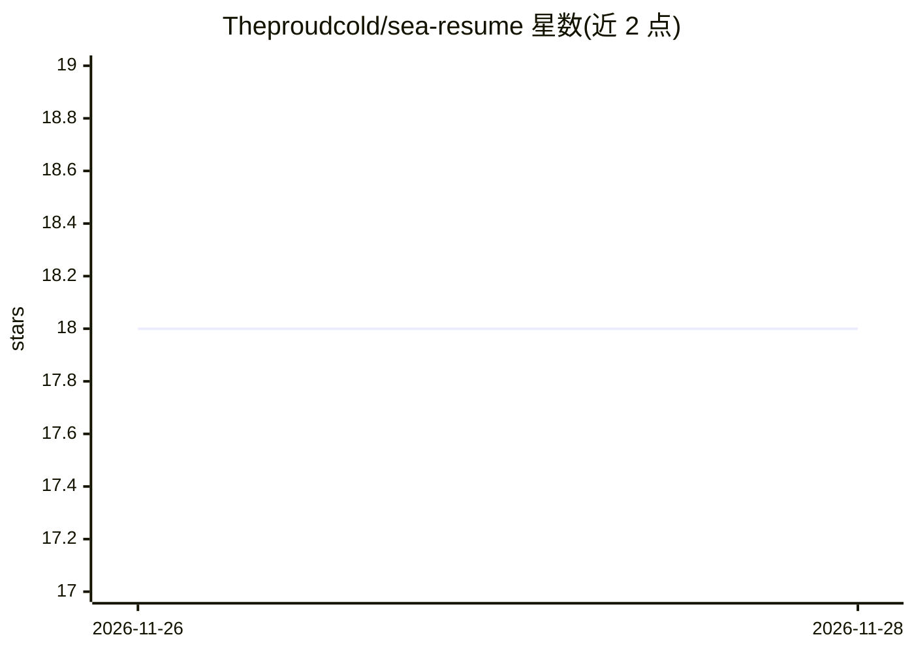

# Theproudcold/sea-resume

⭐ 18 · TypeScript · MIT · 推送 2026-11-26 · [GitHub](https://github.com/Theproudcold/sea-resume) · [官网](https://blog.hypoy.cn/sea-resume/) · 个人维护 · 中文 README

**求职者的纯前端简历工作台，带 AI 优化与版本管理**

基于 Vue 3 + TypeScript 的纯前端简历制作与求职辅助工作台，无需后端，数据默认留在浏览器或授权的本地目录。提供 11 套模板、三栏可视化编辑、Git 风格的岗位版本图谱与差异同步、可搜索 PDF/图片/Markdown 导入导出。AI 部分包括三角色简历优化流水线、不调用模型的确定性事实校验、JD 风险判读与模拟面试；支持 OpenAI 兼容服务、Ollama/LM Studio 本地模型与 MCP 外部 Agent 三种接入方式，基础编辑不依赖 AI 配置。

## 筛选速览

| 维度 | 判定 | 备注 |
|---|---|---|
| AI 角色 | `ai-enhanced` | 去掉 AI 部分产品仍成立 |
| 许可风险 | `permissive` | MIT |
| 部署形态 | `library` | 以包/库形式分发 |
| 模型依赖 | local-ok | 支持本地模型 |
| 硬件要求 | — | 无带数字的原话,不猜 |
| 安装摩擦 | `low` | 无编译、无系统依赖或容器化 |
| 成熟度 | — | 结构信号不足 |

## 能力要点

- 11 套内置模板与 A4 一页适配、无截断分页导出
- Git 风格岗位版本图谱、差异对比与同步主干
- 确定性事实校验拦截 AI 虚构数字与指标偷换
- MCP 桥接接入 Codex/Claude Code 等外部 Agent，免网页 API Key

## 适用场景

- 为不同公司与岗位维护独立定制简历版本
- 用 AI 改写简历经历并核验没有编造数据
- 粘贴 JD 提前识别岗位风险表述
- 无账号在多设备间同步简历数据

## 场景标签

`AI 写作` · 领域:内容生成

## 证据(README 行号)

> L15: Sea Resume 是一款基于 **Vue 3 + TypeScript** 构建的纯前端简历制作与求职辅助工作台。从整理经历、管理多岗位版本，到 AI 简历优化、模拟面试与多格式导出，全程在浏览器内完成，无需后端账号，基础编辑
> L56: - **岗位判读（纯本地、零调用）**：粘贴 JD 即时匹配 8 类常见风险表述（加班强度、值班补位、职责边界、业务成熟度、薪酬福利、用工性质、协作权责、承诺兑现），输出大白话翻译与面试反问，自动排除否定与要求语境，未配置 AI 
> L60: ### 4. 三种 AI 接入方式（支持免网页 API Key）

## 星数曲线

2026-11-26 18 → 2026-11-28 18（+0）

---
*卡片 v1 · prompt 1.4 · 生成 2026-11-27 · 置信度 mid · 依据 README sha `11e02a26c89c` · [字段定义](../../DATASET.md)*
