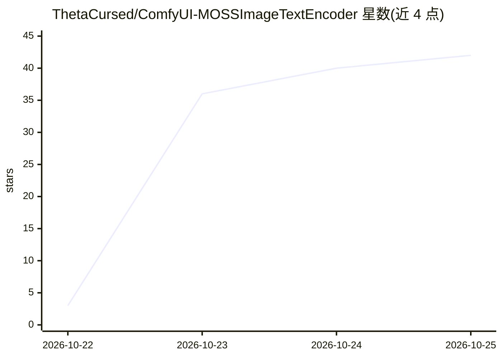

# ThetaCursed/ComfyUI-MOSSImageTextEncoder

⭐ 42 · Python · MIT · 推送 2026-10-21 · [GitHub](https://github.com/ThetaCursed/ComfyUI-MOSSImageTextEncoder) · [官网](https://workflow.thetacursed.com) · 个人维护

**ComfyUI 节点：将参考图经 Qwen3.5-9B 视觉塔注入文本提示词**

面向 ComfyUI 用户的自定义节点：把参考图像送入 Qwen3.5-9B 文本编码器的视觉塔（vision tower），将视觉嵌入直接拼入文本提示词，使图像通过文本编码器原生地条件化生成（MOSS-Image conditioning）。提供 image_weight、vision_megapixels、system_prompt 等参数，附可直接拖入工作区的 workflow.json 示例。仅用于视觉条件化而非图像编辑；需 qwen3.5_9b 文本编码器、moss_image 扩散模型与 flux2-vae 模型文件，经 git clone 到 custom_nodes 目录安装。

## 筛选速览

| 维度 | 判定 | 备注 |
|---|---|---|
| AI 角色 | `ai-ecosystem` | LLM/agent 周边工具 |
| 许可风险 | `permissive` | MIT |
| 部署形态 | `None` |  |
| 模型依赖 | — | README 未给出锁定关系 |
| 硬件要求 | — | 无带数字的原话,不猜 |
| 安装摩擦 | `low` | 无编译、无系统依赖或容器化 |
| 成熟度 | — | 结构信号不足 |

## 能力要点

- 参考图经 Qwen3.5-9B 视觉塔生成嵌入并注入文本提示词
- 支持 image_weight / vision_megapixels / system_prompt 等调节参数
- 附可直接加载的 workflow.json 示例工作流
- 批量参考图可作为多重条件输入

## 适用场景

- 在 ComfyUI 中用参考图条件化 MOSS-Image 模型的生成
- 通过文本编码器原生注入视觉条件做图像生成
- 调试查看组装后的 Qwen3.5 提示词（print_prompt）

## 场景标签

`图像生成` · 领域:内容生成

## 证据(README 行号)

> L3: Feeds a reference image through the Qwen3.5-9B **vision tower** and inserts its visual embeddings directly into the 
> L50: cd ComfyUI/custom_nodes

## 星数曲线

2026-10-22 3 → 2026-10-25 42（+39）

---
*卡片 v1 · prompt 1.4 · 生成 2026-10-25 · 置信度 high · 依据 README sha `e89951cc9725` · [字段定义](../../DATASET.md)*
