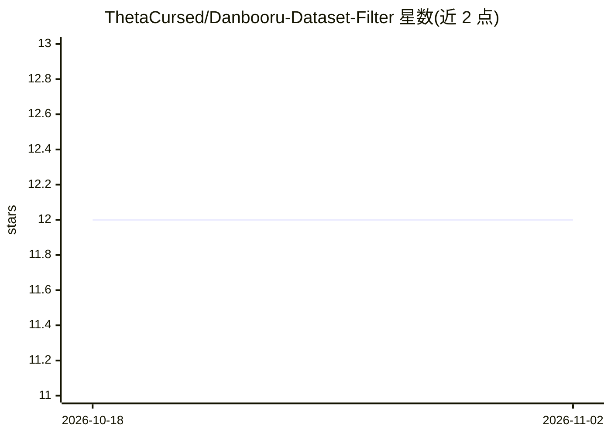

# ThetaCursed/Danbooru-Dataset-Filter

⭐ 12 · Python · MIT · 推送 2026-04-14 · [GitHub](https://github.com/ThetaCursed/Danbooru-Dataset-Filter) · 个人维护

**面向 AI 训练的 Danbooru 图像数据集筛选与导出 GUI 工具**

基于 PyQt6 的桌面 GUI 工具，使用 Polars 引擎与 Parquet 存储对 Danbooru 图像元数据进行筛选、排序与导出，服务于 LoRA、Anima、SDXL、Flux 等训练的数据集准备。支持按 Score、收藏数、日期、评级（SFW/NSFW）过滤，按宽高比筛选，MD5 去重，集成带自动补全的标签词典，实时估算数据集体积，并可将图片 URL 批量导出为 .txt。安装提供 Windows 一键批处理脚本（setup.bat/run_app.bat）或手动 pip 安装依赖并从 Hugging Face 下载约 4GB 元数据文件。

## 筛选速览

| 维度 | 判定 | 备注 |
|---|---|---|
| AI 角色 | `ai-ecosystem` | LLM/agent 周边工具 |
| 许可风险 | `permissive` | MIT |
| 部署形态 | `library` | 以包/库形式分发 |
| 模型依赖 | — | README 未给出锁定关系 |
| 硬件要求 | — | 无带数字的原话,不猜 |
| 安装摩擦 | `low` | 无编译、无系统依赖或容器化 |
| 成熟度 | — | 结构信号不足 |

## 能力要点

- Polars + Parquet 处理百万级记录的元数据筛选
- 按 Score/收藏/日期/评级与宽高比过滤，MD5 去重
- 集成带自动补全与彩色分类的标签词典
- 批量导出图片 URL 至 .txt 并实时估算数据集体积

## 适用场景

- 为 LoRA/Checkpoint 训练准备高质量图像数据集
- 按标签与质量阈值筛选 Danbooru 数据
- 去重并估算训练集存储体积

## 场景标签

 · 领域:AI 训练数据/图像数据集

## 证据(README 行号)

> L5: **Danbooru Dataset Filter** is a high-performance GUI toolkit designed specifically for curating and preparing AI tr
> L8: A must-have tool for AI researchers and model trainers working on:

## 星数曲线

2026-10-18 12 → 2026-11-02 12（+0）

---
*卡片 v1 · prompt 1.4 · 生成 2026-11-01 · 置信度 high · 依据 README sha `fbc275f9e6af` · [字段定义](../../DATASET.md)*
