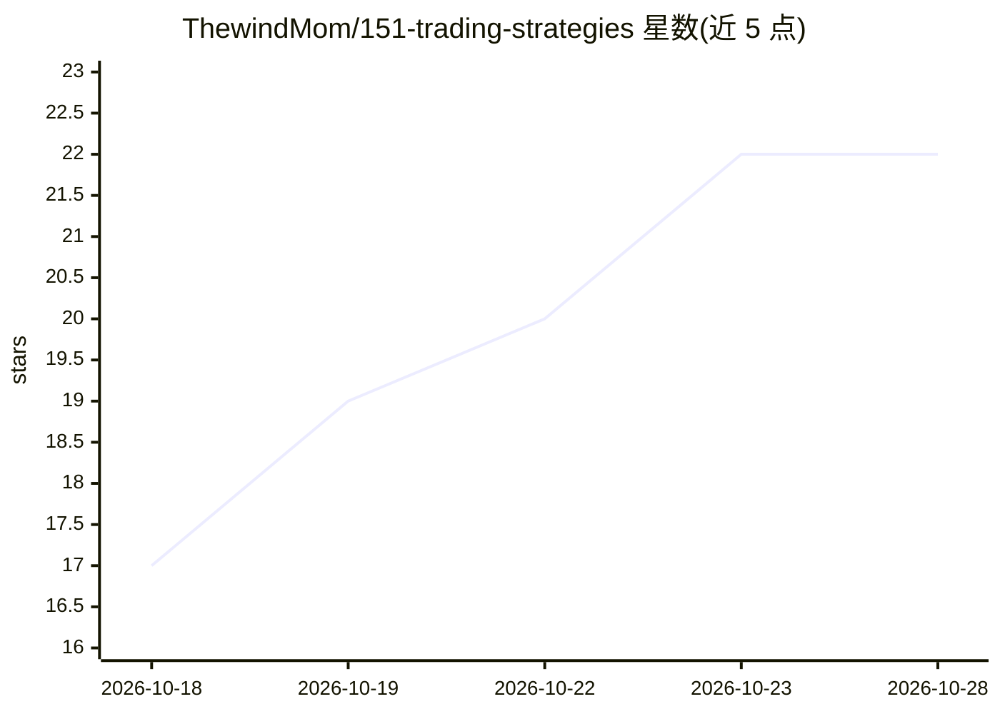

# ThewindMom/151-trading-strategies

⭐ 22 · Python · 推送 2026-10-24 · [GitHub](https://github.com/ThewindMom/151-trading-strategies) · 个人维护

**面向量化开发者的 151 交易策略 FastAPI 实现（68 个非期权策略）**

以 FastAPI 实现论文《151 Trading Strategies》（Kakushadze & Serur, 2018）中 68 个非期权交易策略的 REST API 服务：覆盖股票、ETF、固定收益、指数、波动率、外汇、大宗商品、期货、结构化产品、可转债、加密货币与宏观等 16 类资产，每个策略对应一个 POST 端点；其中少量策略使用机器学习方法（KNN、ANN、情绪分析）。明确排除需期权数据的策略（第 2 节全部及 6.3/7.4/7.5/13.2）。通过 pip 安装依赖并用 uvicorn 启动，自带 Swagger 文档。适用于量化研究与策略原型验证。

## 筛选速览

| 维度 | 判定 | 备注 |
|---|---|---|
| AI 角色 | `ai-enhanced` | 去掉 AI 部分产品仍成立 |
| 许可风险 | `none` | — |
| 部署形态 | `library` | 以包/库形式分发 |
| 模型依赖 | — | README 未给出锁定关系 |
| 硬件要求 | — | 无带数字的原话,不猜 |
| 安装摩擦 | `low` | 无编译、无系统依赖或容器化 |
| 成熟度 | — | 结构信号不足 |

## 能力要点

- 68 个非期权策略按 16 类资产组织为 REST 端点
- FastAPI 自带交互式 API 文档（/docs）
- 少量策略采用机器学习方法（KNN、ANN、情绪分析）
- 明确列出不实现的期权类策略清单

## 适用场景

- 快速调用论文中的交易策略进行量化研究验证
- 为量化原型系统提供统一的策略计算后端
- 按资产类别浏览并测试动量、套利、均值回归等策略

## 场景标签

`金融量化` · 领域:学习与行业

## 证据(README 行号)

> L3: FastAPI implementation of non-options trading strategies from the paper "151 Trading Strategies" by Zura Kakushadze 
> L41: |POST /stocks/knn|3.17 Machine Learning (KNN)|
> L145: |POST /crypto/ann|18.2 ANN (Neural Network)|

## 星数曲线

2026-10-18 17 → 2026-10-28 22（+5）

---
*卡片 v1 · prompt 1.4 · 生成 2026-10-18 · 置信度 low · 依据 README sha `ca138ac69ebe` · [字段定义](../../DATASET.md)*
