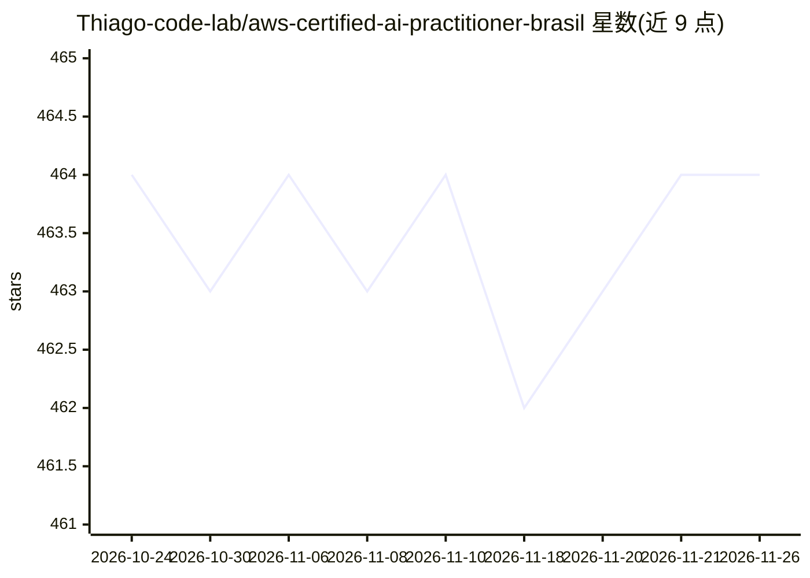

# Thiago-code-lab/aws-certified-ai-practitioner-brasil

⭐ 464 · HTML · MIT · 推送 2026-11-19 · [GitHub](https://github.com/Thiago-code-lab/aws-certified-ai-practitioner-brasil) · [官网](https://www.cloudstudy.com.br/) · 个人维护

**备考 AWS AI Practitioner (AIF-C01) 的葡语开源学习资源库**

该仓库以模块化目录组织 AWS AI Practitioner (AIF-C01) 考试的阅读材料：18 个模块覆盖 AI/ML 基础、生成式 AI 与 LLM、Amazon Bedrock 与 SageMaker 等服务、负责任 AI 与安全治理、数据与提示工程、案例与模拟题，并附闪卡、速查表与词汇表。面向备考 AIF-C01 的葡语初学者，MIT 许可，另有 CloudStudy App 与 Udemy 课程引流，仓库本身为纯文本学习内容，不含可运行的软件。

## 筛选速览

| 维度 | 判定 | 备注 |
|---|---|---|
| AI 角色 | `ai-knowledge` | 知识聚合/清单类 |
| 许可风险 | `permissive` | MIT |
| 部署形态 | `None` |  |
| 模型依赖 | — | README 未给出锁定关系 |
| 硬件要求 | — | 无带数字的原话,不猜 |
| 安装摩擦 | `low` | 无编译、无系统依赖或容器化 |
| 成熟度 | — | 结构信号不足 |

## 能力要点

- 18 个模块按学习路线组织 AIF-C01 考试范围
- 含模拟题、闪卡、速查表与词汇表等复习资源
- MIT 许可、PT-BR 内容的开源学习资料

## 适用场景

- 备考 AWS AI Practitioner (AIF-C01) 认证
- 按模块循序渐进学习 AWS 上的 AI/ML 基础
- 用闪卡与模拟题做考前复习

## 场景标签

`教程课程` · 领域:学习与行业

## 证据(README 行号)

> L55:  Base open source em PT-BR para fundamentos de IA na AWS com navegação premium e trilha de evolução.
> L68: Este repositório organiza os fundamentos de IA e IA generativa na AWS em módulos objetivos, com foco em leitura pro
> L85: ## Módulos

## 星数曲线

2026-10-24 464 → 2026-11-26 464（+0）

---
*卡片 v1 · prompt 1.4 · 生成 2026-11-25 · 置信度 high · 依据 README sha `b9e0677e8e31` · [字段定义](../../DATASET.md)*
