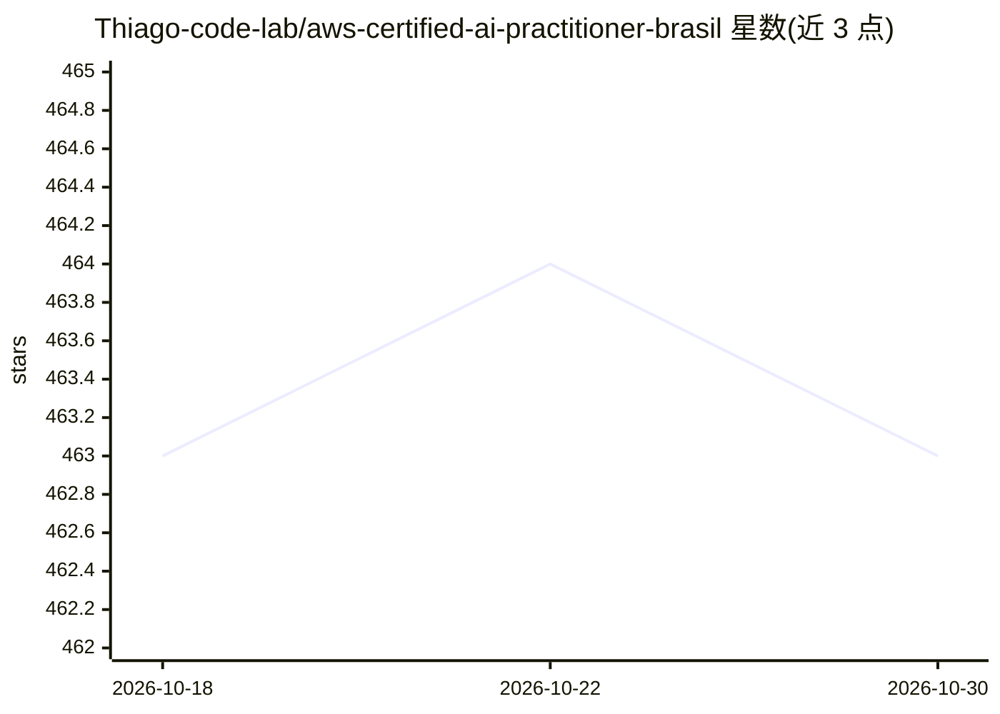

# Thiago-code-lab/aws-certified-ai-practitioner-brasil

⭐ 463 · HTML · MIT · 推送 2026-09-09 · [GitHub](https://github.com/Thiago-code-lab/aws-certified-ai-practitioner-brasil) · [官网](https://www.cloudstudy.com.br/) · 个人维护

**PT-BR 的 AWS AI Practitioner (AIF-C01) 认证备考知识库**

面向巴西葡语使用者的 AWS AI Practitioner (AIF-C01) 认证开源学习资料库：将 IA/ML 基础、生成式 AI、Amazon Bedrock、SageMaker、负责任 AI 与安全合规等内容组织为 18 个渐进式学习模块，附模拟题、术语表、cheatsheets、flashcards 与引导实验。内容以 Markdown 阅读为主，无代码安装；仓库关联 CloudStudy 平台候补名单、Udemy 课程与 WhatsApp 群组。

## 筛选速览

| 维度 | 判定 | 备注 |
|---|---|---|
| AI 角色 | `ai-knowledge` | 知识聚合/清单类 |
| 许可风险 | `permissive` | MIT |
| 部署形态 | `None` |  |
| 模型依赖 | — | README 未给出锁定关系 |
| 硬件要求 | — | 无带数字的原话,不猜 |
| 安装摩擦 | `low` | 无编译、无系统依赖或容器化 |
| 成熟度 | — | 结构信号不足 |

## 能力要点

- 18 个模块覆盖 AIF-C01 考纲（基础→Bedrock/SageMaker→治理→模拟题）
- PT-BR 葡语内容、MIT 许可开源
- 附模拟题、术语表、cheatsheets、flashcards 与引导实验

## 适用场景

- 我想系统备考 AWS AI Practitioner (AIF-C01) 认证
- 用葡语资料理解 AWS 上 Bedrock/SageMaker 等 AI 服务概念
- 考前用模拟题和 flashcards 快速复习

## 场景标签

`教程课程` · 领域:学习与行业

## 证据(README 行号)

> L59: Este repositório organiza os fundamentos de IA e IA generativa na AWS em módulos objetivos, com foco em leitura pro
> L61: |Bloco|O que você encontra|

## 星数曲线

2026-10-18 463 → 2026-10-30 463（+0）

---
*卡片 v1 · prompt 1.4 · 生成 2026-10-21 · 置信度 high · 依据 README sha `4fa420390001` · [字段定义](../../DATASET.md)*
