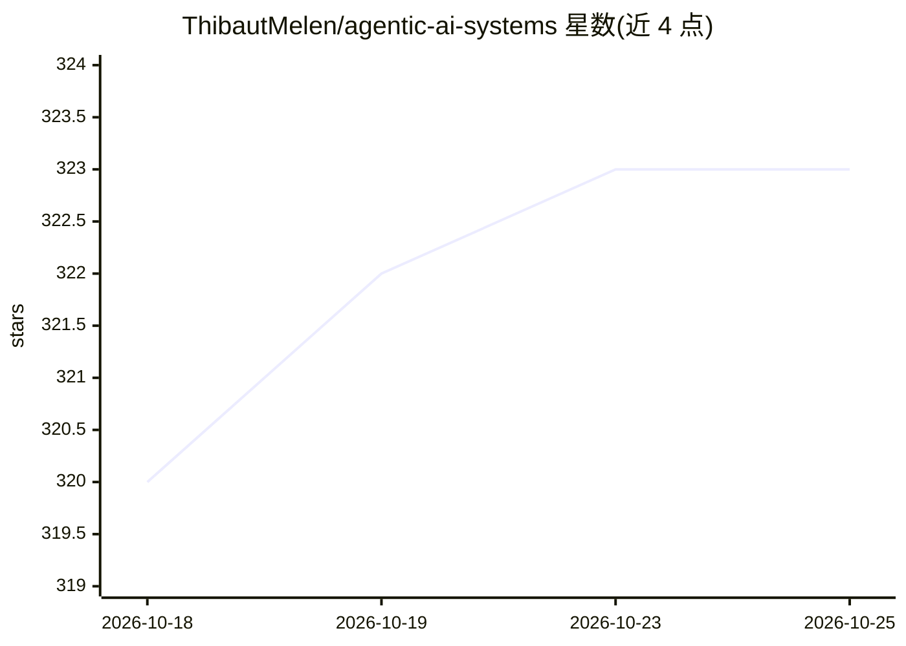

# ThibautMelen/agentic-ai-systems

⭐ 323 · MIT · 推送 2026-07-11 · [GitHub](https://github.com/ThibautMelen/agentic-ai-systems) · 个人维护

**以小鸡比喻讲解 AI agent 模式的教程仓库，模式可运行**

面向学习 agentic AI 架构的知识型仓库：用鸡群比喻解释 Main Agent 与 Subagents 等概念，按 Foundations、Workflows（Prompt Chaining/Routing/Parallelization/Orchestrator/Evaluator）、Autonomous Agent、Implementation 等板块组织内容。2026 版将每个模式做成可运行文件，CI 在每次推送时检查，无需 API key，其中三个模式每日运行真实任务。实现部分围绕 Claude Code 的 Subagent/Command/Skill/Hook 组件展开，附模式选择决策表、术语表与 Anthropic 官方参考链接。

## 筛选速览

| 维度 | 判定 | 备注 |
|---|---|---|
| AI 角色 | `ai-knowledge` | 知识聚合/清单类 |
| 许可风险 | `permissive` | MIT |
| 部署形态 | `None` |  |
| 模型依赖 | — | README 未给出锁定关系 |
| 硬件要求 | — | 无带数字的原话,不猜 |
| 安装摩擦 | `low` | 无编译、无系统依赖或容器化 |
| 成熟度 | — | 结构信号不足 |

## 能力要点

- 按 6 类 Workflow 与 Autonomous Agent 模式组织讲解
- 每个模式提供可运行文件，CI 每次推送检查且无需 API key
- 含 Claude Code 组件实现位置（agents/commands/skills/hooks）与模式选择决策表
- 附 Anthropic 官方文档与参考链接

## 适用场景

- 学习并选型 agentic AI 编排模式（工作流 vs 自主 agent）
- 了解 Claude Code 的 Subagent/Skill/Hook 实现结构
- 以可运行文件方式复用仓库中的 agent 模式

## 场景标签

`教程课程` · 领域:学习与行业

## 证据(README 行号)

> L28: > **New in the 2026 edition** — 🗞️ What Changed 2025-2026 (the dated map: context engineering, the multi-agent deba
> L44: ### ⚙️ Workflows
> L79: |📜 Patterns as Code|Every pattern as a runnable, checkable file|

## 星数曲线

2026-10-18 320 → 2026-10-25 323（+3）

---
*卡片 v1 · prompt 1.4 · 生成 2026-10-22 · 置信度 high · 依据 README sha `b7ad0c5f09d6` · [字段定义](../../DATASET.md)*
