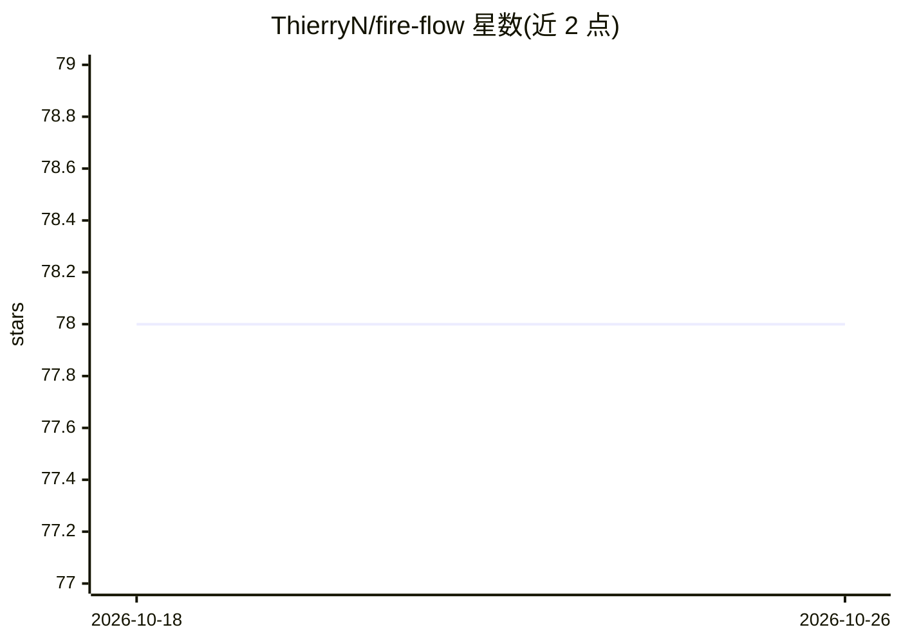

# ThierryN/fire-flow

⭐ 78 · Python · MIT · 推送 2026-08-13 · [GitHub](https://github.com/ThierryN/fire-flow) · 个人维护

**Claude Code 的项目编排插件：结构化流程+会话记忆+质量门**

面向 Claude Code 用户的编排插件：以 51 个斜杠命令组织 Plan→Execute→Verify→Handoff 流水线，提供 51 命令框架、并行执行、70 点验证清单、会话交接与自动技能提取，并内置 Playwright E2E 测试与安全扫描（提示注入/OWASP/凭据泄露）。持久记忆依赖可选 Power Features：Docker 运行 Qdrant 向量库，Ollama 提供 nomic-embed-text 本地嵌入，另可接 hub-mcp 搜索 Docker Hub。安装方式为 git clone 或 ZIP 下载后 claude install-plugin。

## 筛选速览

| 维度 | 判定 | 备注 |
|---|---|---|
| AI 角色 | `ai-ecosystem` | LLM/agent 周边工具 |
| 许可风险 | `permissive` | MIT |
| 部署形态 | `desktop` | 安装包/桌面程序 |
| 模型依赖 | local-ok | 支持本地模型 |
| 硬件要求 | — | 无带数字的原话,不猜 |
| 安装摩擦 | `low` | 无编译、无系统依赖或容器化 |
| 成熟度 | — | 结构信号不足 |

## 能力要点

- 51 个斜杠命令组织 Plan→Execute→Verify→Handoff 流水线
- 基于 Qdrant 向量库的跨会话持久记忆（可选）
- 70 点验证清单与 Playwright E2E 自动测试
- 118+ 可复用技能库与自动技能提取

## 适用场景

- 在 Claude Code 中按结构化流程完成从想法到验证代码的项目开发
- 让 Claude 跨会话记住代码库与既往决策
- 以 /fire-autonomous 让 Claude 自动规划、构建并验证各阶段

## 场景标签

`编码 Agent` `Agent 记忆` · 领域:Agent 开发

## 证据(README 行号)

> L5: Dominion Flow gives Claude a complete, structured way to take your project from idea to finished code — with built-i
> L57: Dominion Flow is designed to be easily installed as a Claude Code plugin. Simply clone the repository and run the i
> L80:    claude install-plugin ./fire-flow

## 星数曲线

2026-10-18 78 → 2026-10-26 78（+0）

---
*卡片 v1 · prompt 1.4 · 生成 2026-10-24 · 置信度 mid · 依据 README sha `f8a4bd78788c` · [字段定义](../../DATASET.md)*
