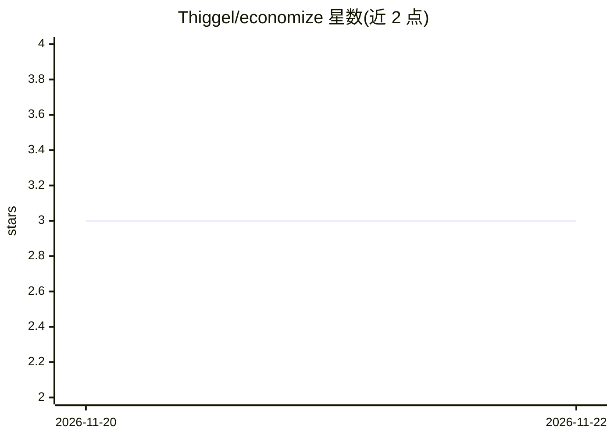

# Thiggel/economize

⭐ 3 · Python · Apache-2.0 · 推送 2026-11-21 · [GitHub](https://github.com/Thiggel/economize) · [官网](https://thiggel.github.io/economize/) · 个人维护

**给 Hugging Face 语言模型叠加可组合推理加速技术的 Python 库**

面向 transformers 因果语言模型的推理效率库，实现 50 余种已发表技术（投机解码、early exit、剪枝、量化、KV cache 压缩等），通过单个函数调用以单独或经验证的组合方式附加到未修改的模型上，并提供 compatible 检查技术间是否可组合。基座模型保持模块与 forward 不变，兼容 generate、PEFT 与 HF Hub 生态；附带的 drafter 可训练并导出到 vLLM/SGLang。要求 Python 3.10+、PyTorch 2.4+、transformers 5.0+；尚不支持带循环层的部分投机解码特性。

## 筛选速览

| 维度 | 判定 | 备注 |
|---|---|---|
| AI 角色 | `ai-ecosystem` | LLM/agent 周边工具 |
| 许可风险 | `permissive` | Apache-2.0 |
| 部署形态 | `library` | 以包/库形式分发 |
| 模型依赖 | local-ok | 支持本地模型 |
| 硬件要求 | — | 无带数字的原话,不猜 |
| 安装摩擦 | `medium` | 含编译或系统依赖之一 |
| 成熟度 | — | 结构信号不足 |

## 能力要点

- 50 余种效率技术可单独或经验证的组合附加，拒绝内核不兼容的组合
- 基座模型保持完整，继续兼容 generate、PEFT、HF Hub
- 内置训练循环或 transformers.Trainer 训练 drafter，可导出 vLLM/SGLang
- 模型 zoo 在 HF Hub 发布多个 EAGLE-3 drafter 及实测 speedup 数据

## 适用场景

- 为 transformers 模型叠加投机解码与量化来降低推理延迟与成本
- 检索某技术可与哪些技术组合并按序附加
- 训练并发布自己的 drafter，导出到 vLLM/SGLang 部署

## 场景标签

`推理引擎` `模型量化` · 领域:训练与推理

## 证据(README 行号)

> L12: economize makes text generation with Hugging Face causal language models faster and cheaper. It implements more
> L27:  `transformers.Trainer`, and export to vLLM and SGLang.

## 星数曲线

2026-11-20 3 → 2026-11-22 3（+0）

---
*卡片 v1 · prompt 1.4 · 生成 2026-11-22 · 置信度 high · 依据 README sha `df4649b75f96` · [字段定义](../../DATASET.md)*
